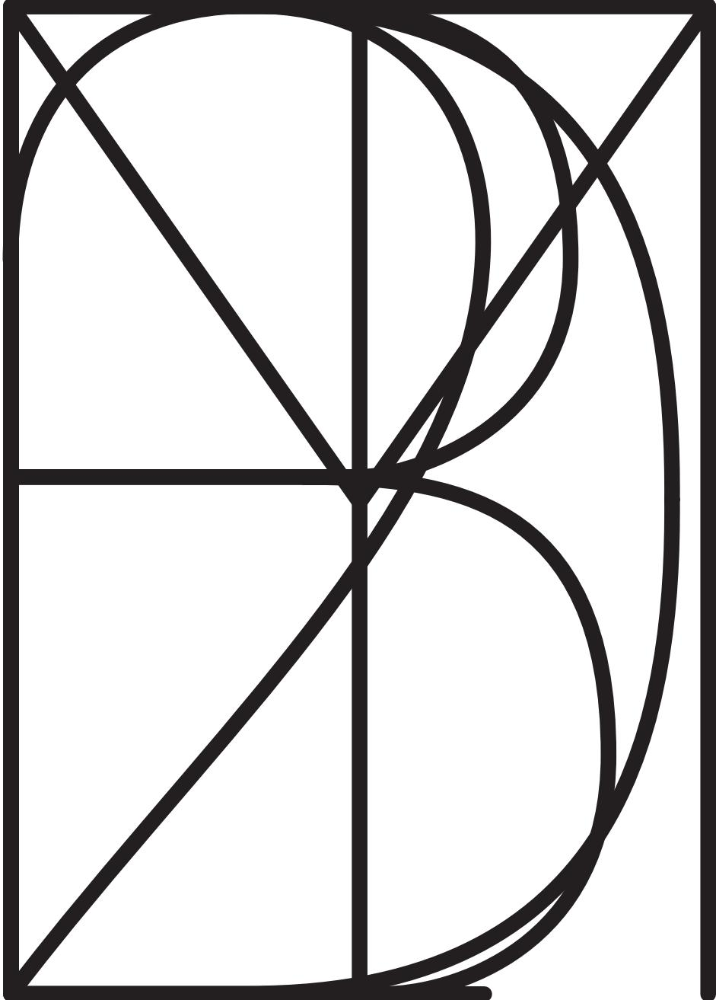

# A NOTE ON THE TYPE

Dexter Sinister

2017

See original publication [here](https://readings.design/PDF/A-Note-on-the-Type-dexter-sinister.pdf).

***

This text was originally written for the book that accompanied the exhibition *The Curse of Bigness*, curated by Larissa Harris at the Queens Museum, New York City, 2010. Since then it has been recomposed and rechanneled through: *Dot Dot Dot 20* (2010); *The Plastic Arts*, an exhibition at Gallery 400, Chicago (2010); *Department of Typography*, an exhibition/publication at *Artissima*, Turin (2010); *Graphic Design Worlds*, an exhibition/publication at Triennale Design Museum, Milan (2011); and *Afterall* #27 (2011). With thanks to Larissa Harris, Anthony Elms, Francesco Manacorda, Giorgio Camuffo, Maddalena Dalla Mura, Pablo LaFuente, and Melissa Gronlund.

Cover image: M-T-D-B-T-2-F composite glyph

PEN = 0, 1, 1, 0, WEIGHT = 100, SLANT = 0, SUPERNESS = 0.75, CURLYNESS = 0:

This is Meta-the-difference-between-the-two-Font, a typeface designed by Dexter Sinister in 2010, and derived using MetaFont, the now-thirty-year-old computer typography system programmed by Donald Knuth in 1979.

MetaFont is both a programming language and its own interpreter, a swift trick where it first provides a vocabulary and then decodes its syntax back to the native binary machine language of 1s and 0s. Knuth originally intended MetaFont as a helper application for TeX, the computer typesetting system he created to facilitate high-quality typography directly by authors. Donald Knuth, a Stanford professor and author of the multi-volume computer science “Bible” *The Art of Computer Programming* (1971), was dismayed on receiving galley proofs for the second edition of his book. The publisher had just switched from traditional hot metal typesetting to a digital system and the typographic quality was far worse than the original 1971 edition. Knuth figured that setting letters on a page was simply a matter of ink or no-ink, on or off, 1 or 0, and therefore a perfect problem for the computer. He planned on spending a six-month sabbatical writing a typesetting program and produced (almost 10 years later) the near-ubiquitous (in mathematics and science publishing, anyway) computer typesetting program, TeX. MetaFont was designed from the start as TeX’s manual assistant and faithful servant, producing as required the high-quality fonts at whatever size and shape on command.

MetaFont was also intended as a tool for designing new typefaces on its own. As MetaFont was programmed by Knuth, a mathematician, the resulting typographic design method relies on equations (multi-variable algebra and a bit of vector arithmetic) to specify letterforms and computer code to compile these instructions into a usable font—all of which is more the native province of mathematicians than type designers.

In the American Mathematical Society’s prestigious Josiah Willard Gibbs Lecture of July 4, 1978, Knuth gave a talk titled “Mathematical Typography,” and suggested that, “We may conclude that a mathematical approach to the design of alphabets does not eliminate the artists who have been doing the job for so many years.” True enough, but the relatively steep technical slope of using MetaFont for type designers combined with the limited interest in making typefaces by mathematicians has resulted in only several handfuls of MetaFonts being produced over the last thirty years. As such, scant documentation and support exists for someone trying to create a MetaFont today.

OK, let’s change the parameters of what you have been reading by setting the following excerpt from a lecture by Bruno Latour titled “What is the Style of Matters of Concern?” (2005) in Meta-the-difference-between-the-two-Font with PEN = 0, 1, 1, 30, WEIGHT = 25, SLANT = -0.1, SUPERNESS = 0.75, CURLYNESS = 30. Like so:

Imagine the following scene: you are trying to build a bridge over a rather tumultuous river. Let’s say that one bank of this river is the “social” and the other, far away, inaccessible, separated by a violent current, by many eddies and dangerous rapids, is the “natural.” Now suppose that, instead of trying to cross this river and build this bridge, you decide instead to GO WITH THE FLOW, that is, to get involved in a bit of canoeing, kayaking or rafting. Then the absence of a bridge is not such a problem. What counts is your ability to equip yourself with the right paraphermalia so that you can go down the river without drowning yourself. You might be scared to get into the turbulent river, you might regret the task of bridge building, but you will probably agree that the two riverbanks are bound to look rather different once you apprehend both of them from the point of view of such a kayaking movement forward. This flowing lateral direction, turned at 90° from the absessive question of bridge building, is, if I am not mistaken, what William James has called “pure experience.”

What I invite you to participate in is a little boat of kayaking, or rafting—and also, I am afraid, a bit of drifting. My question is: what will happen if, instead of trying to bridge the distance between words and worlds, we were trying to move sideways along with the various elements that appear to go in the same direction? What would happen to the “senseless hurrying of matter” called nature if we were to go in the same direction? Would it be as senseless as before? What would happen to the so-called secondary qualities if they were viewed as being that which allows us to grasp the other entities with which we keep moving? Would they appear as “secondary,” their meaning as devoid of any importance and reality as before? My intuition is rather that the two riverbanks would take on an entirely different meaning and that nature, having stapped bifurcating because of the way you have let it pass, will be now able to mingle with our speech and other behaviours in many more interesting connections. This is, at least, the way I would advertise the kayak trip before you embark on it—it’s far you to tell me at the end if I have committed the sin of false publicity ...

Science is ADDING ITSELF to the world. For the bridge builders this addition is impossible without having to be faced with the following choice: either you have to forget the networks of individuals, the welter of equipment, the pullulations of occasions that make it possible, or else you have to deny its truth value and turn it into an illusion, at least a social construction or, slightly better, a useful convention. No wonder: the only movement allowed on the bridge is toward the world or away from it. The only game is a zero sum game. But if the sciences can be added to the flow of experience as yet another way to fold oneself inside it, to let organisms correspond to one another on, so to speak, another wavelength, then you could finally obviate the primary/secondary quality divide, you could, in other words retain the reality of the scientific grasp without its famciful epistemology: nature would have stapped bifurcating ... James defined radical empiricism, what I prefer to call SECOND empiricism, as a way not to choose: we don’t want more than what is given in experience, he said, but we certainly don’t want less either.

In order to code this huge sea change between two empiricisms—the first and the second—I have proposed using the contrast between MATTERS OF FACT and MATTERS OF CONCERN—a banal expression in English that I wish to render more technical. A matter of concern is what happens to a matter of fact when you add to it its whole scenagraphy, much like you would do by shifting your attention from the stage to the whole machinery of a theatre ... Instead of simply being there, matters of fact begin to look different, to render a different sound, they start to move in all directions, they overflow their boundaries, they include a complete set of new actors, they reveal the fragile envelopes in which they are housed. Instead of “being there whether you like it or not” they still have to be there, yes (this is one of the huge differences), they have to be liked, appreciated, tasted, experimented upon, mounted, prepared, put to the test.

It is the same world, and yet, everything looks different. Matters of fact were indisputable, abstinate, simply there; matters of concern are disputable, and their abstinacy seems to be of an entirely different sort: they move, they carry you away, and, yes, they too matter. The amazing thing with matters of fact was that, although they were material, they did not matter a bit, even though they were immediately used to enter into some sort of polemic. How really strange they were.

Unlike more common computer outline font formats such as TrueType or Postscript Type 1, a MetaFont font is constructed of strokes drawn with set-width pens. Instead of describing the outline of the character directly by drawing each letter shape inside and outside, counter and letterform, a MetaFont file describes only the basic pen path or skeleton letter. Perhaps better imagined as the ghost that comes in advance of a particular lettershape, a MetaFont character is defined only by a set of equations rather than hard-coded coordinates and outline shapes. So it is then possible to treat parameters such as aspect ratio, slant, stroke width, serif size, (curlyness!?) and so on as abstracted input values that can change in each glyph definition, creating not a set of set letters, but instead a set of set parameters, any of which can be changed each time the font is rendered. By changing the value at one location in the MetaFont file, a consistent change is produced throughout the entire font. The resulting collection of glyph definitions and input parameters is not then a single font, but instead, a meta-font.

Let’s try that again ... You may recall from earlier that MetaFont is both a language and its own interpreter. (What does that mean?) Taking a clue from that riddle, we could turn MetaFont’s name back on itself, by taking it apart, beginning with the end—“font.”

“Font” is a word whose current common usage (particularly in the context of personal computers) has twisted its exact definition. Returning to its roots, a “font” is simply a collection of characters of one particular design, or precisely, typeface. More specifically a “font” is the particular realization of a certain typeface in a certain medium, according to certain parameters such as size, width, weight, style, contrast and shape—for example, a font of William Caslon’s letters cast in hot lead at 14 points or a font of Standard Grotesque at 96 points carved from oak or even a full font of 12 pixel letters stretched 150% and rendered on a 72-dpi screen from the Arial typeface. However, this collection of parameters (size, width, weight, etc.) according to which a font is rendered from a particular typeface are not fixed. New parameters can be added at will, and this is where the “Meta” of MetaFont begins.

“Meta-” is a prefix of Greek origin that originally simply meant “after,” but due to a strange turn of events\* came to mean “of a higher order, beyond” in Latin and later modern languages (excluding Greek, where it retains its original meaning).

\* Yes, its current use as “of a higher order” is due to Aristotle’s book on the Metaphysics, but he would never have called it that. Aristotle would refer to the subject of that book as First Philosophy or Theology. The title “Metaphysics” comes from Andronicus of Rhodes (1st century BC), who was the first editor of Aristotle and placed the book on the Metaphysics after the book on the Physics in his compilation (so, it was quite literally “after” the Physics). Best regards, Derek

So then you have metalanguages (languages used to describe languages), metahistory (the study of how people view and study history), meta-theorems (theorems about theorems), metarules (rules about rules) etc. Indeed you can “meta” just about anything.\*\*

\*\* Wait, are you guys really calling it “Meta-the-difference-between-the-two-Font”? Sorry man ... it’s a bad name, but you’ll soon realize that yourselves. I won’t press. I’ll just wait around till you see it.

Let’s try another version, demonstrated by typesetting another fragment from another Latour lecture, “A Cautious Prometheus? A Few Steps Toward a Philosophy of Design (with Special Attention to Peter Sloterdijk)” (2008) with PEN = 0, 1, 1, 0, WEIGHT = 25, SLANT = 0, SUPERNESS = 0.71, CURLYNESS = 0, SERIFS = true:

When I was young, the word design (imported to French from English) meant no more than what we now call “relooking” in French (a good English word that, unfortunately, does not exist in English). To “relook” means to give a new and better “look” or shape to something—a chair, a knife, a car, a package, a lamp, an interior—which would otherwise remain too clumsy, too severe or too bared if it were left only to its naked function. “Design” in this old and limited meaning was a way to redress the efficient but somewhat boring emphasis of engineers and commercial staff. Design occurred by adding a veneer of form to their creations, some superficial feature that could make a difference in taste and fashion. Even if design could be greatly admired, it was always taken as one branch of an alternative: look not only at the function, but also at the design. This dichotomy was true even though the best design was one that, in good modernist fashion (as it did in “functionalism”), approximated function as closely as possible. “Design” was always taken in this “not only ... but also” balance. It was as if there were really two very different ways of grasping an object: one through its intrinsic materiality, the other through its more aesthetic or “symbolic” aspects.

From a surface feature in the hands of a not-so-serious-profession that added features in the purview of much-more-serious-professionals (engineers, scientists, accountants), design has been spreading continuously so that it increasingly matters to the very substance of production. What is more, design has been extended from the details of daily objects to cities, landscapes, nations, cultures, bodies, genes, and, as I will argue, to nature itself. It is as though the meaning of the word has grown in what logicians refer to as “comprehension” and “extension.” First, it has grown in comprehension—it has eaten up more and more elements of what a thing is. Today everyone with an iPhone knows that it would be absurd to distinguish what has been designed from what has been planned, calculated, arrayed, arranged, packed, packaged, defined, projected, tinkered, written down in code, disposed of and so on. From now on, “to design” could mean equally any or all of those verbs. Secondly, it has grown in extension—design is applicable to ever larger assemblages of production.

The reason I am interested in the spread in comprehension and extension of the term design is not because of any intimate knowledge of design practice ... Yet I take its expansion as a fascinating tell-tale of a change in the ways we deal with objects and action more generally. If it is true as I have claimed that we have never been modern, and if it is true, as a consequence, that “matters of fact” have now clearly become “matters of concern,” then there is logic to the following observation: the typically modernist divide between materiality on the one hand and design on the other is slowly being dissolved away. The more objects are turned into things—that is, the more matters of facts are turned into matters of concern—the more they are rendered into objects of design through and through.

The transformation of objects into signs has been greatly accelerated by the spread of computers. It is obvious that digitalization has done a lot to expand semiotics to the core of objectivity: when almost every feature of digitalized artefacts is “written down” in codes and software, it is no wonder that hermeneutics have seeped deeper and deeper into the very definition of materiality. If Galileo’s book of nature was written in mathematical terms, prodigiously expanding the empire of interpretation and exegesis, this expansion is even true today when more and more elements of our surroundings are literally and not metaphorically written down in mathematical (or at least in computer) terms. Although the old dichotomy between function and form could be vaguely maintained for a hammer, a locomotive or a chair, it is ridiculous when applied to a mobile phone. Where would you draw the line between form and function? The artefact is composed of writings all the way down! But this is not only true of computerized artefacts and gadgets. It is also true of good old-fashioned materiality: what are nano- or bio-technologies if not the expansion of design to another level? Those who can make individual atoms write the letters “IBM,” those who implant copyright tags into DNA, would certainly consider themselves to be designers. Here again, matter is absorbed into meaning in a more and more intimate fashion.

Now here is the challenge: In its long history, design practice has done a marvellous job of inventing the practical skills for drawing objects, from architectural drawing, mechanic blueprints, scale models, prototyping etc. But what has always been missing from those marvellous drawings (designs in the literal sense) are an impression of the controversies and the many contradicting stake holders that are born within them.

In other words, YOU in design as well as WE in science and technology studies may insist that objects are always assemblies, “gatherings” in Heidegger’s meaning of the word, or things and DINGE, and yet, four hundred years after the invention of perspective drawing, three hundred years after projective geometry, fifty years after the development of CAD computer screens, we are still utterly unable to draw together, to simulate, to materialize, to approximate, to fully model to scale, what a thing in all of its complexity is. We know how to draw, to simulate, to materialize, to zoom in and out on objects; we know how to make them move in 3-D space, to have them sail through the computerized virtual RES EXTENSA, to mark them with a great number of data points, etc. Yet we are perfectly aware that the space in which those objects seem to move so effortlessly is the most utopian (or rather atopic) of spaces. These are the least realistic spaces of circulation ever imagined. They are spaces that do not even fit with the ways in which architects, engineers, designers draw and modify blueprints, nor with the process through which they direct fabrication on the factory floor or manipulate scale models. To use some more German: we know how to draw GEGENSTAND but we have no clue what it is to draw DING. I once asked one of the greatest historians of technology to send me what he considered his best drawing of the marvellously complex history of mechanisms he has been writing about for so long. He sent me some doodle which I would not have dared showing to my first year students as an example of what a thing is. How could this doodle be compared to the comfortable and effortless manner in which objects float through the so called “Euclidian space” of a CAD design or to the ways in which I can visit Falmouth before I arrive there through the apparently smooth travel of Google Earth?

In 2009, The *New Yorker* ran “The Unfinished,” a piece about American writer David Foster Wallace following his death six months earlier. Midway through the tribute, D.T. Max quotes from an early letter that Wallace sent to Gerald Howard of Penguin Books, in which he explains that his work is neither primarily “realism” nor “metafiction,” but rather, “if it’s anything, it’s meta-the-difference-between-the-two.”

Typically, it’s a throwaway line that returns, then stays with you. Does the “difference” here refer to a mathematical distinction in quantity, or to a more common sense of distinction or dissimilarity (or even disagreement)?

Or both? Wallace's chain-of-words is as slippery as the logically-recursive sentence "The first rule is: there are no rules," but with a difference. Instead of simply setting up an endless loop between two poles, it observes that loop from a higher point of concentrated disinterest. There's no simple way out of this one, and yet there seems to be just enough there to keep trying. \*\*\*

\*\*\* Zadie Smith makes a case for this in an essay on Foster Wallace, using his short story "The Depressed Person" from *Brief Interviews with Hideous Men* as arch example: "The effect on the reader is powerful, unpleasant. Quite apart from being forced to share one's own mental space with the depressed person's infinitely dismal consciousness, to read those spiral sentences is to experience that dread of circularity embedded in the old joke about recursion (to understand recursion you must first understand recursion)."

Exporting Wallace's chain from literature to a more general use, we could plug other values into the equation. For "realism" we could insert "practice" and for "metafiction" perhaps "theory." (These poles can be endlessly swapped with similarly productive confusion—try "concrete"/"abstract" or "modernism"/"postmodernism.") And yet the "meta-the-difference-between-the-two" between any of these two isn't simply resolved by some alchemical fusion, as in "practice" + "theory" = "praxis," practice informed by theory and vice versa. Less of a compound than an extraction, more a subtraction than an addition, m-t-d-b-t-2 is then actually a skeleton, a script, or a good idea in advance of its realization.

Donald Knuth began his Josiah Gibbs lecture, "Mathematical Typography" with an apology of sorts, saying: "I will be speaking today about work in progress, instead of completed research; this was not my original intention when I chose the subject of this lecture, but the fact is I couldn't get my computer programs working in time." And he continues, "Fortunately it is just as well that I don't have a finished product to describe to you today, because research in mathematics is generally much more interesting while you're doing it than after it's all done."

Meta-the-difference-between-the-two-Font has a similarly incomplete character. As a set of simple letterforms and a collection of meta-design parameters, M-t-d-b-t-2-F will create unending numbers of different fonts from now onwards, always only moving forward and compiling a collection of surface effects onto its essential skeleton to produce a growing family of “hollow” fonts whose forms have more in common with handwriting than they do with hot metal counterpunches (not to mention modern digital fonts). The clumsy result, with its chewy name Meta-the-difference-between-the-two-Font, arrives before the effect that is applied to it, returning to a moment before fonts, just before Gutenberg’s first black-letter Gothic types attempted to match the scribe’s penmanship. At this point, to computer-automate the production of handwritten calligraphy, and to more or less ignore 400 years of typographic tradition, is essentially absurd.

It seemed like a good idea at the time.

One final trial, this time used to set a piece of Latour’s most recent essay at the time of writing, “An attempt at a ‘Compositionist Manifesto’” (2010) with PEN = 0, 1, 1, 0, WEIGHT = 120, SLANT = 0, SUPERNESS = 0.5, CURLYNESS = 0:

I know full well that, just like the time of avantgardes or that of the Great Frontier, the time of manifestos has long passed. Actually, it is the time of TIME that has passed: this strange idea of a vast army moving forward, preceded by the most daring innovators and thinkers, followed by a mass of slower and heavier crowds, while the rearguard of the most archaic, the most primitive, the most reactionary people, trails behind. During this recently defunct time of time, manifestos were like so many war cries intended to speed up the movement, ridicule the Philistines, castigate the reactionaries. This huge warlike narrative was predicated on the idea that the flow of time had one—and only one—INEVITABLE and IRREVERSIBLE direction. The war waged by the avant-gardes would be won, no matter how many defeats they suffered. What this series of manifestos pointed to was the inevitable march of PROGRESS. So much so that these manifestos could be used like so many signposts to decide who was more “progressive” and who was more “reactionary.”

And yet a manifesto might not be so useless at this point, making explicit (that is, MANIFEST) a subtle but radical transformation in the definition of what it means to progress, that is, to PROCESS forward and meet new prospects. Not as a war cry for an avant-garde to move even further and faster ahead, but rather as a warning, a call to attention, so as to STOP going further IN THE SAME WAY as before toward the future. The nuance I want to outline is that between PROGRESS and PROGRESSIVE. It is as if we had to move from an idea of inevitable progress to one of TENTATIVE AND PRECAUTIONARY PROGRESSION. There is still a movement. Something is still going forward. But the tenor is entirely different. And since it seems impossible to draft a manifesto without a word ending with an -ism (communism, futurism, surrealism, situationism, etc.), I have chosen to give this manifesto a worthy banner, the word COMPOSITIONISM. Yes, I would like to be able to write “The Compositionist Manifesto” by reverting to an outmoded genre in the grand style of old, beginning with something like: “A specter haunts not only Europe but the world: that of compositionism. All the Powers of the Modernist World have entered into a holy alliance to exorcise this specter!”

Even though the word “composition” is a bit too long and windy, what is nice is that it underlines that things have to be put together (Latin COMPONERE) while retaining their heterogeneity. Also, it is connected with composure; it has clear roots in art, painting, music, theater, dance, and thus is associated with choreography and scenography; it is not too far from “compromise” and “compromising,” retaining a certain diplomatic and prudential flavor. Speaking of flavor, it carries with it the pungent but ecologically correct smell of “compost,” itself due to the active “de-composition” of many invisible agents. Above all, a composition can FAIL and thus retains what is most important in the notion of CONSTRUCTIVISM (a label which I could have used as well, had it not been already taken by art history). It thus draws attention away from the irrelevant difference between what is constructed and what is not constructed, toward the crucial difference between what is WELL or BADLY constructed, well or badly composed. What is to be composed may, at any point, be DEcomposed.

In other words, compositionism takes up the task of searching for universality but without believing that this universality is already there, waiting to be unveiled and discovered. It is thus far from relativism as it is from universalism. From universalism it takes up the task of building a common world; from relativism, the certainty that this common world has to be built from utterly heterogeneous parts that will never make a whole, but at best a fragile, revisable and diverse composite material.

\*
