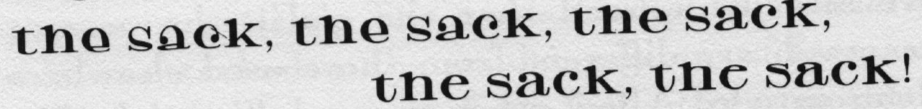
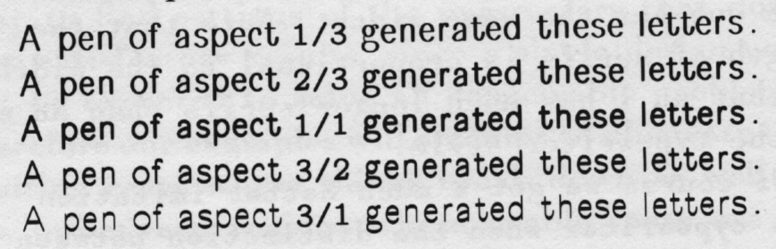
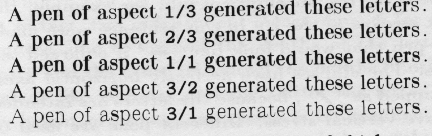
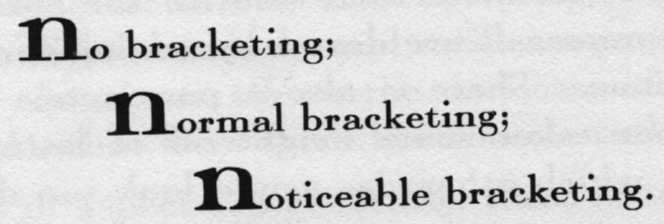
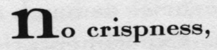
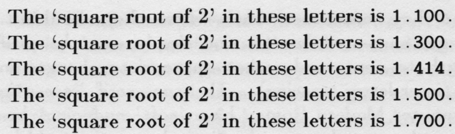
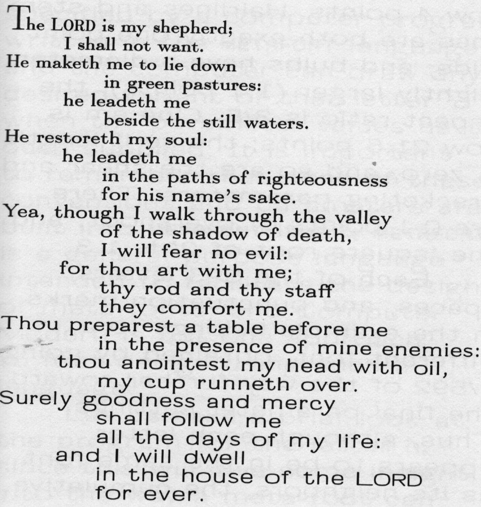

# The Concept of a Meta-font

Donald E. Knuth

1982

See original publication [here](https://veryinteractive.net/pdfs/knuth-theconceptofameta-font.pdf).

***

**Editors note:** It truly does not make sense to read this text as it’s presented here on its own. The original design is crucial to understanding the content. This particular format exists only to cleanly extract the text so that it might be translated into other languages or used with assistive technology such as text-to-speech. In some cases I have tried to insert screenshots of the original design, but they are a weak translation. Please read this text alongside its original design.

\*\*\*

> A single drawing of a single letter reveals only a small part of what was in the designer's mind when that letter was drawn. But when precise instructions are given about how to make such a drawing, the intelligence of that letter can be captured in a way that permits us to obtain an infinite variety of related letters from the same specification. Instead of merely describing a single letter, such instructions explain how that letter would change its shape if other parameters of the design were changed. Thus an entire font of letters and other symbols can be specified so that each character adapts itself to varying conditions in an appropriate way. Initial experiments with a precise language for pen motions suggest strongly that the font designer of the future should not simply design isolated alphabets; the challenge will be to explain exactly how each design should adapt itself gracefully to a wide range of changes in the specification. This paper gives examples of a meta-font and explains the changeable parameters in its design.

Some of Aristotle's philosophical writings were called *Metaphysics*, because they came *after* his *Physics*, in the conventional arrangement of his works. By the twentieth century, most people had forgotten the original meaning of Greek prefixes, so that 'meta-' was assumed to add a transcendent character to whatever it qualified. We now have metapsychology (the study of how the mind relates to its containing body), metamathematics (the study of mathematical reasoning), and metalinguistics (the study of how language relates to culture); a metamathematician proves metatheorems (theorems about theorems), and a computer scientist often works with metalanguages (languages for describing languages). Newly coined words beginning with 'meta-' generally reflect our contemporary inclination to view things from outside, at a more abstract level, with what we feel is a more mature understanding.

In this sense a 'meta-font' is a *schematic description of how to draw a family of fonts*, not simply the drawings themselves. Such descriptions give more or less precise rules about how to produce drawings of letters, and the rules will ideally be expressed in terms of variable *parameters* so that a single description will actually specify many different drawings. The rules of a meta-font will thereby define many different individual fonts, depending on the settings of the parameters. For example, the American Type Founders specimen book of 1923 included the following members of its 'Caslon' family: plain, oldstyle, lightface, bold, heavy, condensed, lightface condensed, bold condensed, extra condensed, bold extended, shaded, and openface, not to mention American Caslon, New Caslon, Recut Caslon, and Caslon Adbold; each of these was available in about sixteen different point sizes, so the total number of Caslon roman fonts was about 270. There was an overall design concept loosely tying all these fonts together so that they were recognizably 'Caslon', although the changes in size and weight were accompanied by more or less subtle changes in the letter shapes. We can regard this overall design as a meta-font that specified how the letters would change in different circumstances—the meta-font governed the metamorphoses.

Of course, the actual design of all these Caslon varieties was not completely explicit; it was conveyed implicitly by means of a few drawings that specified a few critical examples. A skilled workman could make the appropriate modifications for intermediate sizes and styles just as skilled animators do the 'in-betweening' for Walt Disney cartoons. It would be preferable, however, to have a completely explicit design, so that the designer's intentions would be unambiguously recorded; then we wouldn't have to resort to the vague notion of 'appropriate modifications'. Ideally, the designer's intentions should be so explicit that they can be carried out satisfactorily by somebody who doesn't understand letter shapes at all—even by a stupid, inanimate, electronic computer!

George Forsythe once wrote that 'The question "What can be automated?" is one of the most inspiring philosophical and practical questions of contemporary civilization.' We know from experience that we understand an idea much better after we have succeeded in teaching it to someone else; and the advent of computers has brought the realization that even more is true: The best way to understand something is to know it so well that you can teach it to a computer. Machines provide the ultimate test, since they do not tolerate 'hand waving' and they have no 'common sense' to fill the gaps and vagaries in what we do almost unconsciously. In fact, research in artificial intelligence has shown that computers can do virtually any task that is traditionally associated with 'thinking,' but they have great difficulty accomplishing what people and animals do 'without thinking.' The art of letter design will not be fully understood until it can be explained to a computer; and the process of seeking such explanations will surely be instructive for all concerned. People often find that the knowledge gained while writing computer programs is far more valuable than the computer's eventual output.

In order to explain a font design to a machine, we need some sort of language or notation that describes the process of letter construction. Drawings themselves do not suffice, unless the design is so simple that all fonts of the family are related to each other by elementary transformations. Several notations for the precise description of letter shapes have been introduced in recent years, including one that the author developed during 1977–1979. The latter system, called METAFONT, differs from previous approaches in that it describes the motion of the center of a 'pen' or 'eraser' instead of describing the boundary of each character. As a result, the METAFONT language appears to facilitate the design of font families; for example, it took only about two weeks of work to create the crude but passable meta-font described in reference \[5\].

After another six months of development, during which literally thousands of refinements were made, the design of this prototype meta-font has reached its current state, which was used to typeset the present article. The name Computer Modern has been attached to the resulting group of fonts, a family that includes meta-fonts for both roman and italic styles in addition to the Greek and Cyrillic alphabets and an upper-case calligraphic script, together with an extensive set of mathematical symbols. The basic idea underlying the design of this font family was to capture the spirit of the 'Monotype Modern Extended 8A' fonts used in the first printings of the author's books on computer programming, but to cast the design in the METAFONT idiom and to include a wide range of parametric variations.

So many variations are possible, in fact, that the author keeps finding new settings of the parameters that give surprisingly attractive effects not anticipated in the original design; the parameters that give the most readability and visual appeal may never be found, since there are infinitely many possibilities. On the other hand, it would be possible to parameterize many other things that cannot be varied in the present design; an almost endless series of interesting experiments can be performed, now that METAFONT is available.

Computer Modern Roman has 28 parameters that affect the shapes of its letters, plus three parameters that help control inter-letter spacing. There are also a few miscellaneous parameters whose sole function is to select alternate character and ligature shapes in different fonts. For example, one of the latter parameters is used to select between two styles for the letter 'g'; the reader may have already noticed that the g's in the present paragraph are different from those used elsewhere in this article. A few other typographic tricks like this will be played in what follows; large type has been used so that the effects will not be impossible to perceive.

The most interesting and important parameters of Computer Modern will be changed in the following paragraphs, one at a time, in order to show how much variability is possible. Of course it is easy to find settings of the parameters that don't give satisfactory results, since a single design cannot be expected to solve all conceivable problems; therefore our examples will attempt to illustrate the limiting cases where things break down as well as the in-between regions where usable fonts are to be found.

The first and most obvious group of parameters controls the vertical dimensions of letters: The x-height and the heights of ascenders and descenders can be independently specified. There are, in fact, two independent measurements for descenders, one to control the depths of the letters gjpqy and the other to control the depths of other symbols like commas and the tail of the letter Q. The height of upper-case letters is independent of the height of lower-case letters, and the height of the numerals 0 to 9 can also be varied at will. The most unusual parameter relating to vertical dimensions is called the e-height, namely the height of the bar in a lower-case e; in the current designs the e-height also affects several other lower-case letters:

**the sack, the sack, the sack,**  
**the sack, the sack!**

Another fairly obvious group of parameters governs the horizontal dimensions of the characters: It is possible to obtain fonts that are extremely extended or extremely condensed without changing the heights or widths of the strokes.2 One can also imitate a typewriter by extending or condensing the individual characters so that each one has the same width. Note that the length of serifs is proportional to the width, so that an i has much longer serifs than an m in the typewriter style.

Of course we get a much better imitation of a typewriter when the distinction between thick and thin strokes disappears. Such a font looks typewriter-like even when its letters do not all have the same width.

The letters of Computer Modern are all drawn by pens having an elliptical nib; for example, the thick strokes of the h's in this sentence were made by a pen that would look like '⬬' if enlarged ten times. The ellipses have perfectly horizontal axes, not tipped as ‘/’ \[Editors note: this is meant to be a diagonal ellipse, but there is no unicode character for it.\], because the letters are intended to have vertical stress. Different pens are used to draw different parts of the letters.

Five parameters control the dimensions of these elliptical pens: One for the thin hairlines, another for thick stem lines that are straight, another for thick stem lines that are curved, another for the bulbs on letters like acf...y, and another that gives an aspect ratio between horizontal and vertical dimensions. The height of the hairline pen is used also as the height of the pens that draw the thick vertical stem lines. If the first four of these pen-width parameters are equal and if the aspect ratio is 1/1, the pens will be perfect circles.

An ellipse like ' ⬬ ' has an aspect ratio of 1/3, while the aspect ratio of ' ⬮ ' is 3/1. It is interesting to see what happens when sans-serif letters are drawn with pens of different aspect ratios:

> A pen of aspect 1/3 generated these letters.
>
> A pen of aspect 2/3 generated these letters.
>
> A pen of aspect 1/1 generated these letters.
>
> A pen of aspect 3/2 generated these letters.
>
> A pen of aspect 3/1 generated these letters.

Editor note: this is a screenshot of how this text was printed

The aspect ratio can also be varied when the pens have different widths and serifs are present; in this case the aspect affects the darkness of letters like g and s that have thick horizontal strokes:

> A pen of aspect 1/3 generated these letters.
>
> A pen of aspect 2/3 generated these letters.
>
> A pen of aspect 1/1 generated these letters.
>
> A pen of aspect 3/2 generated these letters.
>
> A pen of aspect 3/1 generated these letters.

(In the examples above, the widths of thick vertical stems for aspect ratios less than 1 are equal to the heights of thick horizontal stems for aspect ratios greater than 1.)

Special care is needed in the choices of the pen-width parameters. For example, undesirable blotches appear when the bulbs are too large for the stems; and the type has a disturbing inconsistency when the curved stems are substantially wider than the straight ones. A **font cannot get too bold without having portions of the letters run into each other**. Perhaps future meta-fonts will be set up to compute desirable pen dimensions from a smaller set of independent parameters, since the proper widths depend in a subtle way on each other; at the moment, trial and error is necessary to get a compatible set of pens, but further research should shed some light on this dependence.

Only five pen-width parameters have been mentioned, for simplicity, but the actual situation is somewhat more complex. In the first place, the pens used for drawing upper-case letters are specified separately from those used to draw the lower-case ones, and numerals are drawn by mixing these two specifications. There is also a parametric 'fudge factor' that takes some weight off of letters like w and m, which otherwise would look too dark in some styles; true uniformity in line widths does not lead to uniform appearance, because our eyes play tricks on us.

Another slightly subtle parameter of the Computer Modern fonts is the so-called 'overshoot' by which curves and sharp corners descend below the baseline and above the mean line. For example, the letters in this sentence have no overshoot at all. And certain letters in this sentence overshoot their boundaries by thrice as much as they do in the following sentences. Experimentation is still necessary to find the amount of overshoot that makes the letters look most stable, and on low resolution printing equipment it is desirable to eliminate overshoot entirely; further study of this parameter, in combination with the others, would be quite interesting.

Serif details can be varied in several ways. For example, there are no 'sheared' serifs on the letters in this sentence. And the letters you are now reading have thrice as much shear as usual, just to make sure that the concept of shear is clear. Another serif-oriented concept is the amount of 'bracketing'; the serifs in this sentence have no brackets. But the brackets are exaggerated in this sentence, so the serifs appear darker. The difference can be understood most easily if we enlarge the letters;

> **N**o bracketing;
>
> **N**ormal bracketing;
>
> **N**oticeable bracketing.

A curve that starts at the edge of the serif will be tangent to the stem at some distance above or below the serif; this vertical distance is the 'bracketing' parameter.

A third parameter affecting serifs is called the 'crispness': The example serifs above have been crisply squared off, using a special rectangular pen instead of an ellipse, but one can also specify

> **N**o crispness,

in which case only the elliptical pens are used. The typewriter-like font examples above are non-crisp.

The length of serifs is, of course, controllable too. The letters in this sentence have serifs that are 50% shorter than before. And in this sentence they are 50% longer than before—so long that they sometimes touch where they shouldn't. To get sans-serif letters, one simply sets the serif length to zero (and makes appropriate changes in the inter-letter spacing). The sans-serif letters in Computer Modern Roman have 'soft' endpoints because they are drawn with elliptical pens; it would be possible to get crisp edges by extending the Computer Modern routines, but sans-serif fonts were not given high priority in this particular design.

A 'slant' parameter transforms the pen motion, as shown in this sentence, but the pen shape remains the same. The degree of slant can be negative as well as positive, if unusual effects are desired. *Too much slant leads; of course, to letters that are nearly unreadable.* Perhaps the most interesting use of the slant parameter occurs when Computer Modern Italic fonts are generated without any slant: Italic letters have a different style from roman, and we are so used to seeing such letters slanted forward that they appear to be slanting backward when they are actually upright or slanting slightly forward.

The final parameter we shall discuss is the most interesting one; it is called 'the square root of 2'. From a mathematical standpoint, there is of course only one square root of 2, but the Computer Modern meta-fonts treat \\sqrt{2} as a variable parameter that is used to compute the 45° points when a pen is drawing elliptical curves. As a result, a value that is smaller than the true one will change an ellipse to a super-ellipse and open up the bowls, while a higher value will have the opposite effect:

> The 'square root of 2' in these letters is 1.300.
>
> The 'square root of 2' in these letters is 1.414.
>
> The 'square root of 2' in these letters is 1.500.
>
> The 'square root of 2' in these letters is 1.700.

Several additional parameters can be varied in addition to those we have mentioned; for example, there is an amount by which sharp corners in letters like V and M are spread apart to avoid unnecessary fill-in, and some parameters such as the serif length are specified independently for upper-case and lower-case letters. But a complete description of Computer Modern Roman is beyond the scope of this paper.

We have been studying the parameters one at a time—what happens when they are all changing at once? The next page shows one of the interesting transformations that are possible. At the top we have a font with an old-fashioned feeling, essentially the same as the style of type used so far in the text of this paper, except for scale: The h-height is 8.4 points, the x-height is 4 points, the e-height is 2.3 points, and the descender depth is 3 points. Hairlines are 0.26 points wide, compared to 1.2-point straight stems and 1.34-point curved stems; the bulb diameter is 1.36 points and the aspect ratio is 1/1. One em in this style equals 12.6 points; serifs are .07777 of an em long, and they have 0.54 points of shear, 0.8 points of bracketing. The overshoot parameter is 0.3 points, and the 'square root of 2' has its mathematically correct value 1.414214.

Continuous variation of parameters can gradually convert a font with an old-fashioned flavor into a contemporary style. All of the letters in this example have the same h-height, but their em width increases as their x-height increases. This gives a perspective effect in which the words come out of the past to the present, as they approach the future.

The letters at the end of the example on the previous page have been transformed into an almost hypermodern font, which will be used for the remainder of this article. The h-height is still 8.4 points, but the x-height has grown to 6.4 points and the e-height to 3.2; the descender depth is now 4 points. Hairlines and stem lines are both exactly one point wide, and bulbs have a diameter slightly larger (1.1 points); the aspect ratio is 3/5. One em is now 21.6 points; the serif length is zero, and so are the shear and bracketing parameters. There are 0.1 points of overshoot, and the 'square root of 2' is 1.3.

Each of the 593 letters, spaces, and punctuation marks in the example belongs to a different font, obtained by going 1/592 of the way further toward the final parameter settings. Thus, although each letter appears to be in the same font as its neighbors, the cumulative change is quite dramatic—it is something like the gradual changes in our own faces as we grow older, except that this typeface is getting younger.

Hundreds of typefaces have appeared in this article, yet all of them belong to the Computer Modern Roman and Italic meta-fonts. Each letter has been specified by a computer program written in the **METAFONT** language, and the computer can draw any desired variant of that letter when the parameter values have been supplied. It is important to remember that none of these conventions and parameters are built into **METAFONT** itself; **METAFONT** is a general-purpose language intended to facilitate the design of meta-fonts, and Computer Modern is but one approach to font design using such a language.

Let us take a brief look at the program for the letter h, since this will give some insight into the way a meta-font can be designed. Each Computer Modern Roman *h* is drawn essentially as follows, if we paraphrase the **METAFONT** code into English:

> This character will be 10 units wide, where there are 18 units per em; however, the width should be adjusted by the 'serif correction' after the character has been drawn, to account for long or short serifs.
>
> There are several key points in this letter, defined as follows: Take an elliptical pen whose height is equal to the hairline width times the aspect ratio, and whose width is equal to the straight stem width for lower-case letters. When this pen is centered at point 1, its center is approximately 2.5 units from the left edge of the character (rounded so that the center is in a good position with respect to the raster), and its top is at the h-height for lower-case letters. Point 2 is directly below point 1; the bottom of the pen will be exactly at the baseline when its center is at point 2. Points 3 and 4 both lie approximately 2.5 units from the right edge of the character; point 4 is directly to the right of point 2, while point 3 is 1/3 of the way from the e-height to the x-height.
>
> Take the pen and draw a straight stem from point 1 to point 2, and another from point 3 to point 4. Put a sheared serif at the left of point 1, and attach serifs at both sides of points 2 and 4, using the serif sub-programs (which take proper account of the shear, bracketing, crispness, and serif-length parameters).
>
> Finally, the shoulder of the *h* is drawn as follows: The stroke begins vertically at a point 1/8 of the way from the e-height to the x-height, using a hairline pen positioned flush right with the left stem line. This hairline pen traces a quarter-ellipse, ending at a point that is horizontally centered in the character and such that the pen's top is at the x-height plus half of the overshoot; let us call this point 5.
>
> The shoulder is completed by drawing one quarter of a superellipse from point 5 to point 3 as the pen grows from the hairline width to the straight stem width; the midpoint of this arc is computed by using the geometric mean of the number 1.23114413 and the 'square root of 2' parameter, instead of \\sqrt{2}, in the usual formulas for ellipses. (The strange constant 1.23114413 is 2^{3/10}, chosen so that Piet Hein's famous superellipse will be obtained if the 'square root of 2' equals \\sqrt{2}.)

Similar routines will yield the *m* and the *n*. Effects of the ‘slant' parameter are not mentioned in this description, since slanting is done by a different part of the computer program, at the time the actual drawing is being produced.

The idea of a meta-font should now be clear. But what good is it? The ability to manipulate lots of parameters may be interesting and fun, but does anybody really need a 6\\frac{1}{7}-point font that is one fourth of the way between Baskerville and Helvetica?

We might consider also an analogy with music: Musical notation was developed centuries before we had a notation for drawing; during all this time there has been no widely perceived need for meta-symphonies, so why should we desire meta-fonts?

Well, these are legitimate questions that surely deserve to be answered; let's think about the musical analogy first. Mankind's long experience with musical notation shows clearly that the mere existence of a precise language does not by itself call for the introduction of parameters into that notation. Indeed, parameters have not crept into serious music, even in primitive ways, until very recently, except in a few almost-forgotten pieces like Mozart's meta-waltz \[11\]. It would surely be interesting and instructive to write meta-music that would produce variable degrees of suspense, excitement, pathos, sturm and drang in the listener, depending on the setting of certain parameters; but there would be little apparent use for such music except in the sound track of motion pictures.

All analogies break down, of course, and font design is different from musical composition because alphabets are not symphonies; an alphabet is a 'medium' while a symphony is a 'message'.. We get a much better analogy between fonts and music when we consider background music rather than symphonies; since fonts serve as the background for an author's printed ideas. Many people resent background music because they feel that music should either be the main focus of a person's attention or it should be absent entirely, while it is generally agreed that the reader of a book should not be conscious of the g's and the k's in that book. A font should be sublime in its appearance but subliminal in its effect.

The utility of parametric variations comes from mankind's need for variety. We don't all want to live in identical houses or drive identical cars. Background music becomes especially tedious when it comes from a limited score having only a few motifs; and five centuries of typographic practice have witnessed a continual craving for new alphabets and for large families of related alphabets. Thus, although any one particular setting of a meta-font's parameters may seem to be somewhat silly and unnecessary, the ability to choose arbitrary parameter settings fills a real need.

Book designers and the designers of advertising copy will have greater freedom than ever before when they have several meta-fonts to work with. Personalized fonts and one-time-only fonts will also be easy for anyone to obtain.

Another reason why meta-fonts and meta-music were not highly developed long ago is the fact that computers did not exist until recently. People find it difficult and dull to carry out calculations with a multiplicity of parameters, while today's machines do such tasks with ease.

Perhaps the most important practical result of parametric variations is the ability to make adjustments for each point size; the contemporary tendency to obtain 7-point fonts by 70% reduction of 10-point fonts has led to a lamentable degradation of quality. Another advantage is that a meta-font can adapt its curves so that they are properly 'rounded' for the digital typesetting machines that are based on discrete rasters. This leads to a significant reduction in the need for manual editing of the raster patterns.

It is, of course, quite a challenge to design a meta-font instead of a single font. A designer wants to remain in control, yet the great variety of possible parameter settings means that the meta-font is able to generate infinitely many alphabets, most of which will never be seen by human eyes; only a few of the possibilities can really be looked at, much less fine-tuned, before the specification of the meta-font has been completed. On the other hand, the designer of a meta-font has compensating advantages, because it is often convenient to be able to postpone making decisions about many aspects of a design and to leave them as parameters, instead of 'freezing' their specifications in the initial stages. Such things as the amount of overshoot, the width of hairlines, the length of serifs, and so on, need not be decided once and for all; it is easy to ask the computer to make experiments by which the designer will be able to choose the best settings of these subtle quantities after viewing actual typeset material. Experiments of this kind would be unthinkable if each character had to be drawn individually—i.e., if each character were simply in a font rather than a meta-font.

In the long run the scientific aspects of meta-fonts should prove to be the most important. The ability to adjust continuous parameters makes it possible to carry out controlled experiments about how such variations affect readability or visual appeal. And even more significant will be the knowledge that will be explicitly embedded in the descriptions of meta-fonts. For example, the author learned a great deal about font design while refining the Computer Modern alphabets, and this information is now accessible to anybody who reads the **META-FONT** code. It is tantalizing to think how much further the art of font design will be advanced when professionals who really know the subject begin to create meta-fonts in an explicit language like **METAFONT**.

## Annotated Bibliography

The nine-point type used to set this bibliography reflects the parameter settings for Computer Modern Roman that were used in its original design, based on the 'Monotype Modern 8' font; the more extreme settings used to typeset the text of the paper were chosen long after the design itself was complete, in order to illustrate the meta-font concept.

\[1\] P. J. M. Coueignoux, *Generation of roman printed fonts*, Ph.D. thesis, Dept. of Electrical Engineering, M.I.T., June 1975. This thesis represents the first use of sophisticated mathematical curves to describe letter shapes to a computer. Coueignoux and his students are presently continuing this research at the École Nationale Supérieure des Mines de Saint-Etienne, France. \[2\] Adrian Frutiger, *Type Sign Symbol* (Zürich: ABC Verlag, 1980); see especially pages 15–21, which describe 'Why Univers was designed and how it developed.' Univers was the first true meta-font, in the sense that a wide variety of different sizes and weights played a central rôle in its design from the very beginning. 'The decisive factor for the many new design possibilities provided by Univers was that it became possible, for the first time, to work with a set of typefaces as a complete system.' Page 59 of this fascinating book shows a meta-letter n, called the 'proportional schema of a typeface family,' graphically depicting the desirable stroke variations as the font gets bolder.

\[3\] Peter Karow et al., 'IKARUS: computer controlled drafting, cutting and scanning of characters and signs. Automatic production of fonts for photo-, CRT and lasercomp machines. Summary.' (September 1979.) This booklet is available from URW Unternehmensberatung, Karow Rubow Weber GMBH, Harksheider Straße 102, 2000 Hamburg 65, Germany. The IKARUS system is now widely used to capture the shapes of letters in mathematical form, based on original artwork \[cf. *Baseline 3* (1981), 6–11\]. The computer programs will also interpolate between different weights, although the number of independent parameters is quite limited; this feature was used successfully by Matthew Carter to develop several weights of his new Galliard type, including Ultra Roman \[cf. Charles Bigelow, 'On type: Galliard,' *Fine Print 5* (1979), 27–30\].

\[4\] David Kindersley and Neil Wiseman, 'Computer-aided letter design,' *Printing World* (October 31, 1979), 12, 13, 17. Discusses the ELF system at Cambridge University, which features a novel method of optical spacing between letters.

\[5\] Donald E. Knuth, 'Mathematical typography,' *Bulletin of the American Mathematical Society* (new series) 1 (March 1979), 337–372; reprinted with corrections as part 1 of *TEX and METAFONT: New Directions in Typesetting* (Providence, R.I.: American Mathematical Society, and Bedford, Mass.: Digital Press, 1979). A paper written shortly after the author began his research on font generation; it explains the initial motivations for this work and shows an experimental roman meta-font. 

\[6\] Donald E. Knuth, 'The letter S,' *The Mathematical Intelligencer 2* (1980), 114–122. Discussion of the letter that is most difficult to incorporate into a parameterized meta-font. 

\[7\] Donald E. Knuth, *Seminumerical Algorithms*, Volume 2 of *The Art of Computer Programming* (Reading, Mass.: Addison-Wesley, 1981). This book was the first large work to be typeset entirely with the Computer Modern meta-fonts; indeed, Computer Modern was developed expressly for the books in this series. The design of Computer Modern had still not been fully completed at the time of printing; for example, the x-height settings were slightly higher than they are now, and certain characters like '2' have been revised. However, the alphabets in the present paper were obtained from those in *Seminumerical Algorithms* by making only a few dozen refinements. Such revisions and afterthoughts are probably inevitable, especially when the computer representation of a meta-font makes changes so easy; it is very hard to stop and say 'there will be no more improvements made!'

\[8\] Donald E. Knuth, *The Computer Modern Family of Type Faces*, a book in preparation, will contain the complete **METAFONT** programs for the Computer Modern Roman and Italic meta-fonts. A preliminary version of this book was published as Stanford Computer Science report STAN-CS-80-780 (January 1980), in order to illustrate the state of the work at that time, but hundreds of important refinements have been incorporated since those early days.

\[9\] J. R. Manning, 'Computer-aided footwear design: A method of constructing smooth curves,' Research report 251, Shoe and Allied Trades Research Association (December 1972, revised February 1953); available from Satra House, Rockingham Road, Kettering, Northants NN16 9JH, England. The clothing industry has needs analogous to those of type designers; this paper discusses the generation of curves that pass through given key points, and it includes a 'meta-shoe' as an example.

\[10\] H. W. Mergler and P. M. Vargo, 'One approach to computer assisted letter design,' *Visible Language* \[néé *The Journal of Typographic Research*\] 2 (1968), 299-322. This paper describes the first computer system for parametric letter design; it included a meta-font for upper-case roman letters. The approach was limited and unsuccessful because it was entirely based on edge generation with a limited class of curves and because of the equipment limitations of the 1960s, but the authors had laudable goals.

\[11\] Wolfgang A. Mozart, *Musikalisches Würfelspiel*, Edition Schott 4474 (Mainz: B. Schott's Söhne, 1957); see also Köchelverzeichnis 516f Anh. C30.01. This unusual score presents a waltz that can be played in 759,499,667,966,482 different ways, since there are eleven possibilities for most of the individual bars; the harmonic principles have been analyzed by Hermann Scherchen in *Gravesaner Blätter* 4 (May 1956), 3-14. Mozart also devised a meta-contredanse, and the British Museum reportedly owns a meta-score by Haydn. A noteworthy 20th-century example of meta-music can be found in *The Schillinger System of Musical Composition* by Joseph Schillinger (two volumes), New York: Carl Fischer, 1946.

\[12\] Edward Rondthaler, 'From the rigid to the flexible,' *Penrose Annual* 53 (1959), xv, 1-9. An early description of the variability of type that is possible with photographic transformations alone.

The research reported in this paper was supported in part by National Science Foundation grants IST-7921977 and MCS-7723738, and in part by the IBM Corporation. The author also wishes to thank Charles Bigelow, Matthew Carter, Douglas Hofstadter, Jill Knuth, and Michael Parker for numerous suggestions that helped to improve the presentation; and he owes a special debt of gratitude to Hermann Zapf for dozens of invaluable suggestions that helped greatly to improve the design of the Computer Modern meta-fonts. This paper was typeset on an Alphatype CRS machine, using software developed by the author and an interface developed by David R. Fuchs. Apologies are made to language purists who object to mixing Greek and Latin stems: The Greek equivalent of *fons* is πγή, so a word like 'metapep' might be superior to 'metafont'. However, such a name would not be readily understood by people who encounter it for the first time, at least not until the day that the science of font design becomes known as pegology.
