# Towards Relational Design (from Walker Art Center blog)

Andrew Blauvelt

Walker Art Center (2008)

See original publication [here](https://www.scribd.com/document/236480112/Andrew-Blauvelt).

***

## Towards Relational Design (Walker Art Center blog)

by **Andrew Blauvelt** at 12:27 pm 2008-11-10

The following is extracted from a series of lectures about relational design practices. A related article can be found at **Design Observer**.

A seemingly random selection of projects from various design fields with an underlying thread:

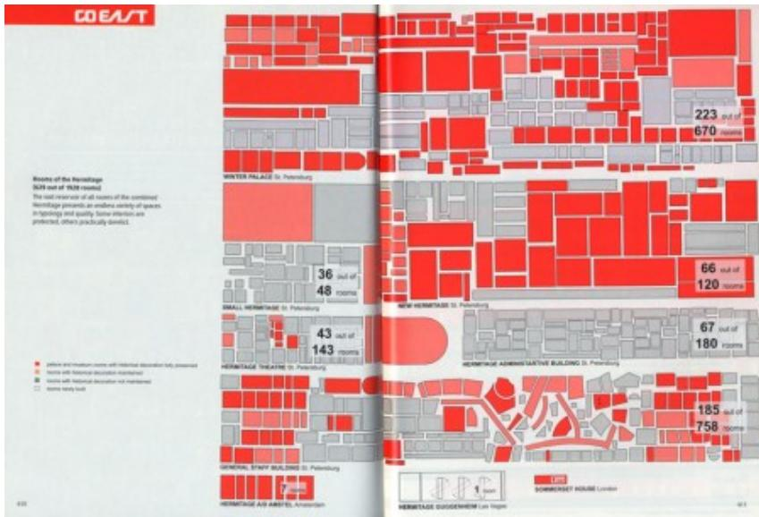

Rem Koolhaas/OMA, Hermitage Museum expansion plan, St. Petersburg, Russia, c. 2003.

An expansion strategy for the Hermitage Museum in Russia simply annexes the surrounding government-owned buildings in St. Petersburg, increasing the available space for objects from 629 to 1928 rooms.

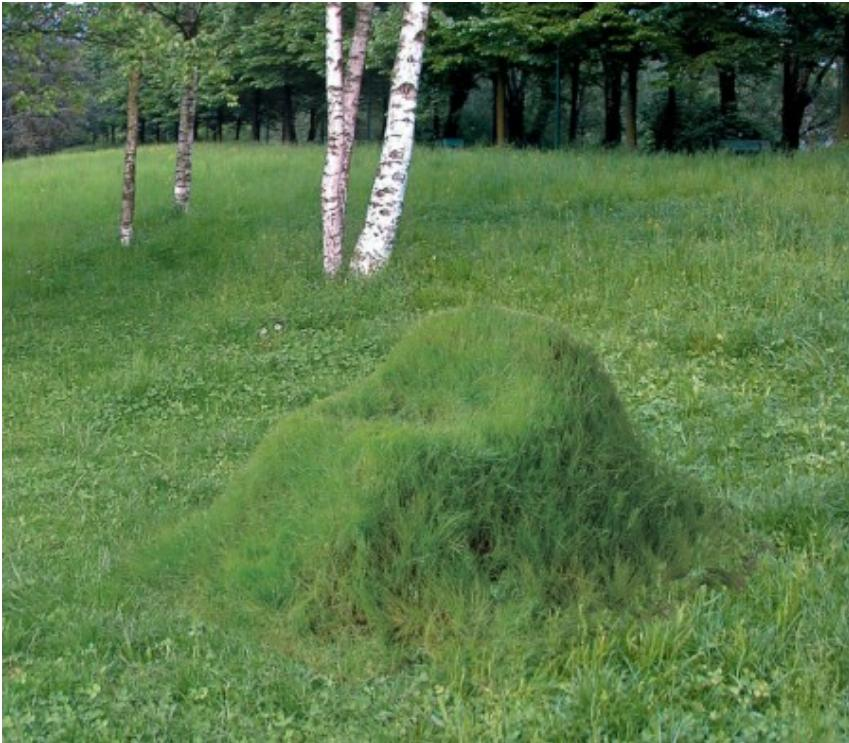

Nucleo, Terra: The Grass Arm-Chair, 2000

A chair made of grass must be grown and then trimmed and watered by its owner in order to remain functional.

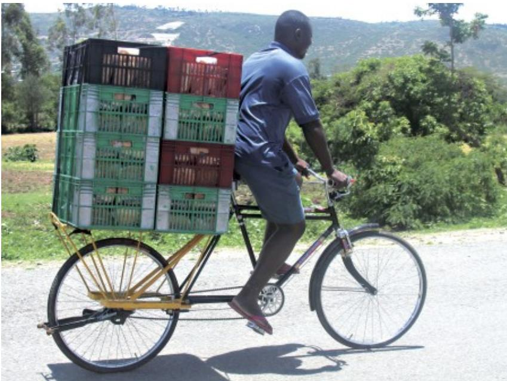

Worldbike.org, Big Boda cargo bicycle, Kenya, 2002-2005.

A worldwide group of bicycle enthusiasts borrow the open source model for redesigning and modifying inexpensive passenger bikes for transporting cargo in developing countries.

LettError, Twin, typeface for the Twin Cities commissioned by the Design Institute at the University of Minnesota, 2003.

A typeface designed for a city alters its weight and appearance based on changes in the reported air temperature.

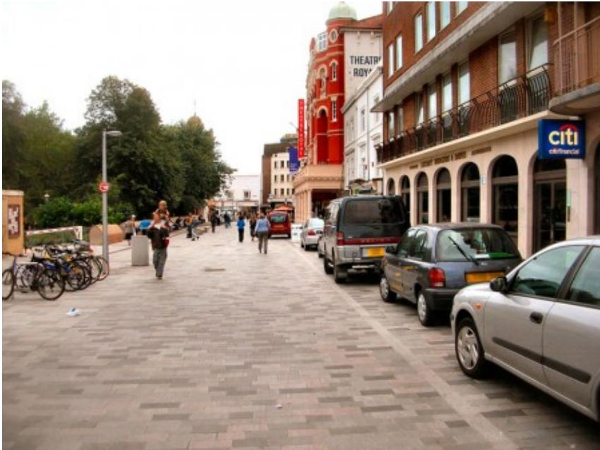

Shared Space concept in England, c. 2005, most likely by Ben Hamilton Baillie after Hans Monderman's schemes.

A Dutch city removes all of its traffic markings and signage in order to reduce collisions between motorists, bicyclists, and pedestrians by increasing awareness among those sharing the roadway.

Diller, Scofidio + Renfro, Blur Building, Swiss Expo 2002

A pavilion on a lake containing thousands of jet nozzles adjusts to atmospheric conditions and dispenses a continuous mist around itself, the resulting fog both conceals and reveals the structure: a scaffolding with no "real" building.

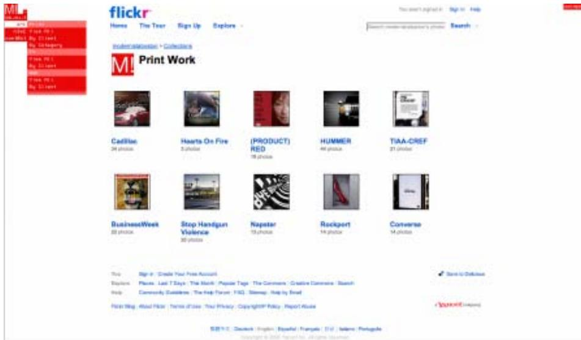

Modernista! website, 2008

An advertising company launches its new “website,” which exists as a small navigation bar overlaid on any referencing page, directing users outward to preexisting forums such as Flickr and MySpace for much of its content.

#### THREE PHASES OF DESIGN

The history of modern design can be viewed in three successive phases, moving from form to content to context; or, in the parlance of semiotics, from syntax to semantics to pragmatics.

This third phase of design—which could go by several names including relational, contextual, and conditional design—follows and departs from twentieth-century experiments in both form and content, which have traditionally defined the spheres of avant-garde practice. Relational design is preoccupied with design’s effects, extending beyond the form of the design object and its attendant meanings and cultural symbolism. It is concerned with performance or use, not as the natural result of some intended functionality but rather in the realm of behavior and uncontrollable consequences. It embraces constraints and seeks systematic methodologies, as a way of countering the excessive subjectivity of most design decision-making. It explores more open-ended processes that value the experiential and the participatory and often blur the distinctions between production and consumption.

Some examples of design as they move from form to content to context:

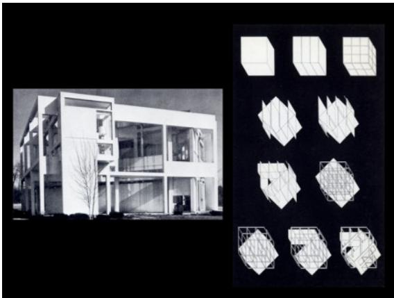

fig. 1 : Peter Eisenman, House series, c. 1970, a formal language in which architectural elements such as columns and walls were separate from a "functional context," used instead as part of a "marking or notational system;"

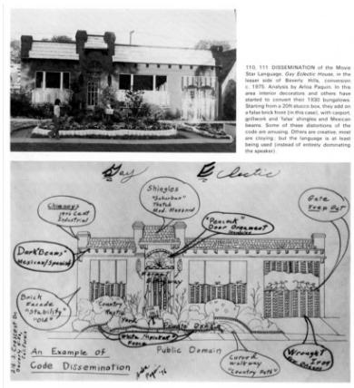

fig. 2 : Content analysis of vernacular architectural languages, in this case the meaning and symbolism of "movie star mansion" iconography applied to bungalows around Los Angeles, 1975 (analysis by Arloa Paquin)

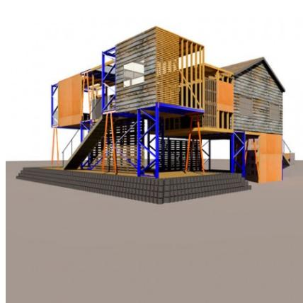

fig. 3: Estudio Teddy Cruz, as part of Manufactured Sites, 2008, a prefabricated metal framework, a designed element, is introduced into the ad-hoc, indigenous building practices of Tijuana's suburban shantytown sprawl.

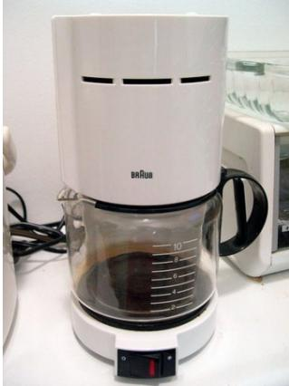

fig. 4: Dieter Rams, Braun Aeromaster 10 Cup Coffeemaker; a classically modern approach to simplifying the visual form of the product and process of coffeemaking

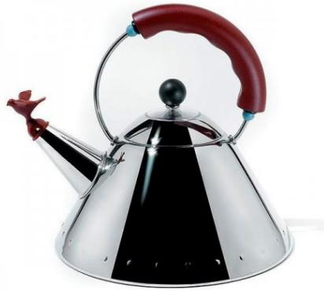

fig. 5: Michael Graves, Tea Kettle for Alessi, 1985, the bird connoting the sound of the whistle;

fig. 6: Naoto Fukasawa, Rice Cooker for Muji, 2002, which has a rice paddle rest on its flat top, solving the problem of where to place this utensil after use. The rice cooker's form is a result of its relationship both to the paddle and to the behavior of the user.

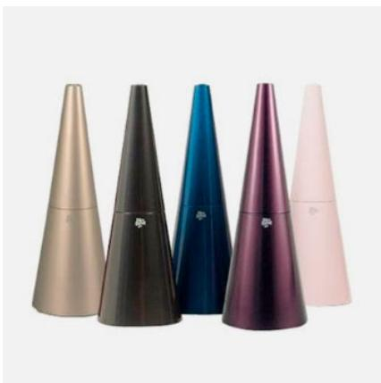

fig. 7: Karim Rashid, Dirt Devil Kone vacuum, 2006, in a form so refined “you can leave it on display”

fig. 8: Dyson DC15 vacuum cleaner, 2005, the articulation of the “ball,” the pivoting wheel of the vacuum, as well as its color-coded parts, imparts and expresses its functionality

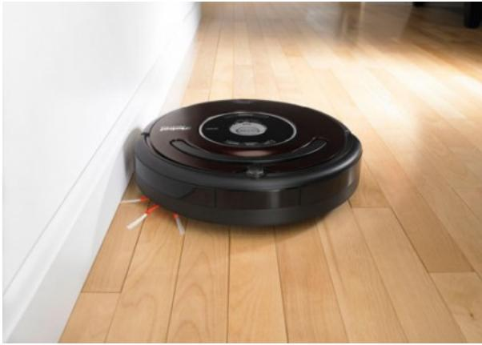

fig. 9: unlike its predecessors iRobot’s Roomba vacuum cleaner, 2002-, maintains a relationship to the room rather to the hand of its owner and uses various algorithms to complete its cleaning tasks

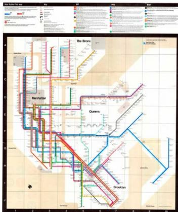

fig. 10: Vignelli Associates, New York City Subway Map, c. 1972, a classic of modern information design and the belief in the clarity of abstract form in communication

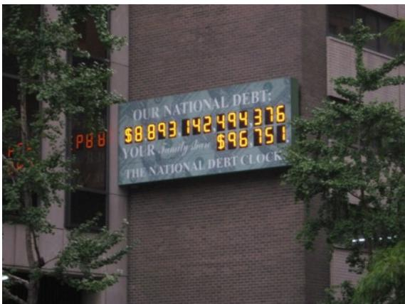

fig. 11: Durst Organization, The National Debt Clock, New York, NY: “a symbol and metaphor, particularly highlighting the fact that the clock ran out of digits when the U.S. public debt rose above $10 trillion on September 30, 2008”

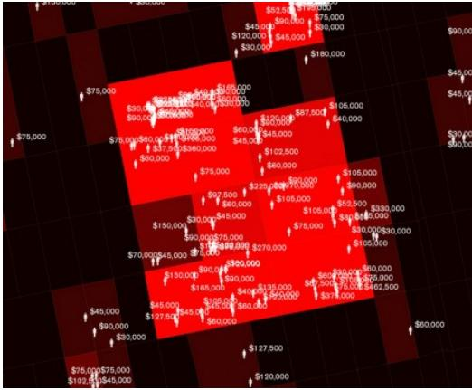

fig. 12: Laura Kurgan, Spatial Information Design Lab, from Million Dollar Blocks project, c. 2006: informatic mapping of individual incarceration costs to inmates’ former neighborhoods in the hopes of shaping public policy

### **CHARACTERISTICS OF RELATIONAL DESIGN**

<table border="1">
<thead>
<tr>
<th></th>
<th>SYNTAX FORM</th>
<th>SEMANTICS CONTENT</th>
<th>PRAGMATICS CONTEXT</th>
</tr>
</thead>
<tbody>
<tr>
<td rowspan="2">ROLE</td>
<td>DESIGNER</td>
<td>AUTHOR</td>
<td>EDITOR</td>
</tr>
<tr>
<td>PRODUCER</td>
<td>CONSUMER</td>
<td>PROSUMER</td>
</tr>
<tr>
<td rowspan="2">PHILOSOPHY</td>
<td>STRUCTURALISM</td>
<td>POST-STRUCTURALISM</td>
<td>PRAGMATISM</td>
</tr>
<tr>
<td>POPULAR</td>
<td>VERNACULAR</td>
<td>QUOTIDIAN</td>
</tr>
<tr>
<td rowspan="2">CULTURE</td>
<td>ICONIC</td>
<td>IDIOMATIC</td>
<td>PROSAIC</td>
</tr>
<tr>
<td>AESTHETIC</td>
<td>CULTURAL</td>
<td>SOCIAL</td>
</tr>
<tr>
<td rowspan="4">LOGIC</td>
<td>FORMAL</td>
<td>SYMBOLIC</td>
<td>PROGRAMMATIC</td>
</tr>
<tr>
<td>LINEAR</td>
<td>CYBERNETIC</td>
<td>NETWORK</td>
</tr>
<tr>
<td>ITERATIVE</td>
<td>VARIABLE</td>
<td>GENERATIVE</td>
</tr>
<tr>
<td>INFINITE FORMS</td>
<td>VARIABLE INTERPRETATIONS</td>
<td>CONTINGENT SOLUTIONS</td>
</tr>
</tbody>
</table>

In relational design, the role of the designer is closer to that of an editor or a programmer, not an author but an enabler, while the consumer is recast as a more creative agent (in the guise of the designer, DIY-er, hacker, or “prosumer”). It prefers pragmatism over post-structuralism, or Dewey over Derrida, and the prosaic and banal over exotic vernaculars. It is governed by social logic and the network culture of the many to the authorial culture of one. It embraces generative systems over formal iterations and contingent solutions to variable interpretations.

Some examples from one strand of the diagram: open-ended processes and generative systems.

### OPEN-ENDED PROCESSES AND GENERATIVE SYSTEMS

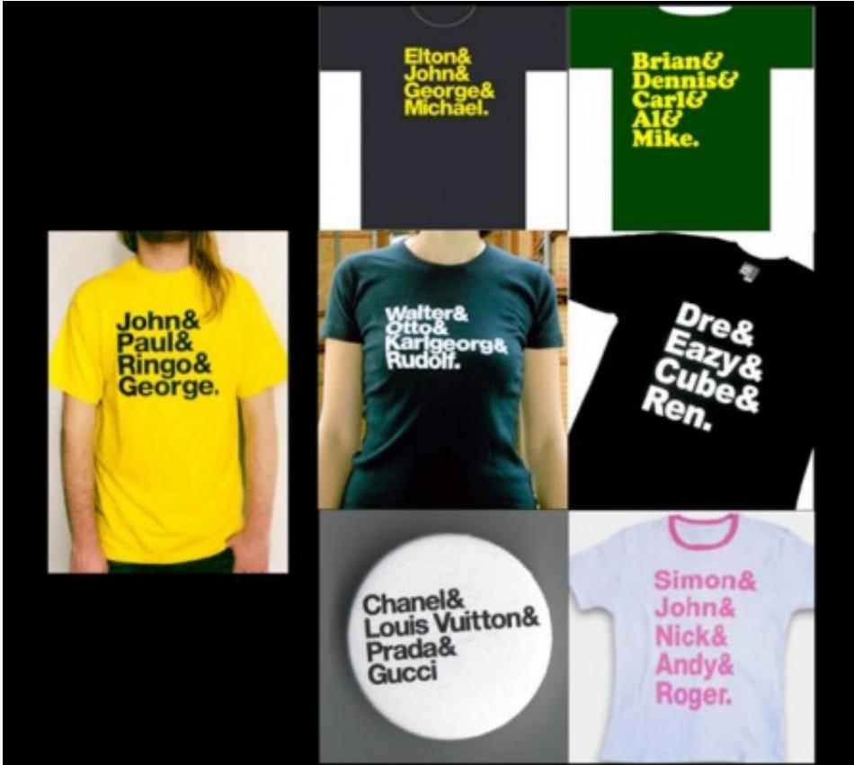

Experimental Jetset, John&Paul&Ringo&George T-shirt, 2001, and variations from others: the archetype as meme.

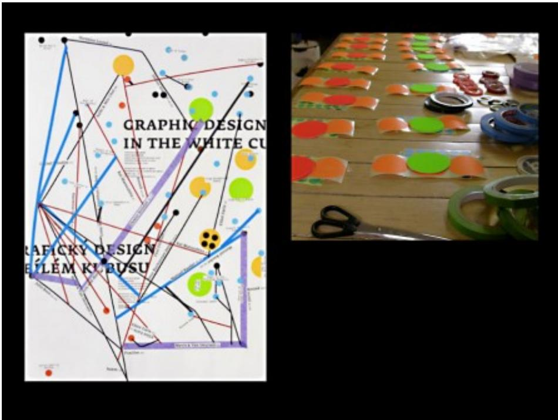

Luna Maurer and Jonathan Puckey, workshop with kits for poster-making using game-like, rules-

based instructions for participants. Graphic Design in the White Cube exhibition, 22nd International Biennale of Graphic Design Brno, 2006.

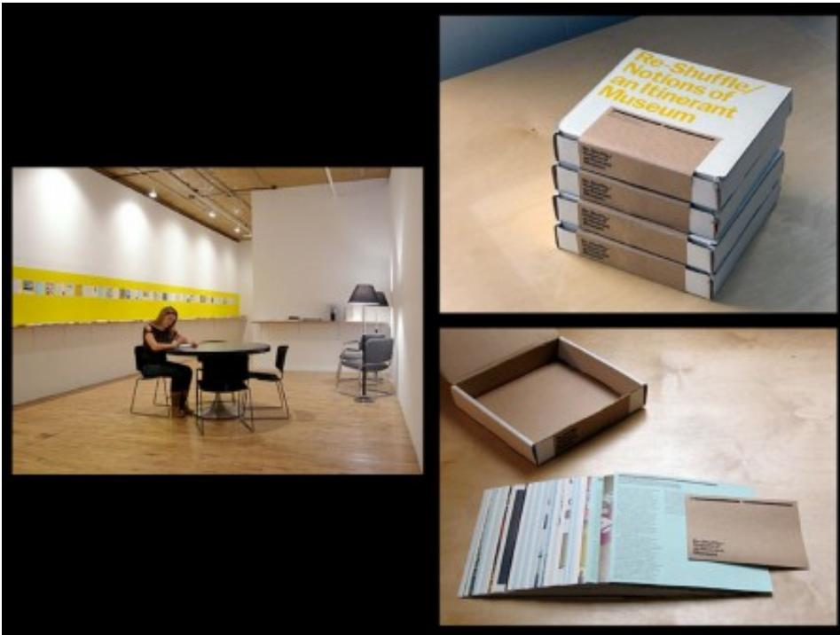

Project Projects, Re-Shuffle/Notions of an Itinerant Museum, Center for Curatorial Studies, Bard College, 2006. Visitors assembled their own portable exhibition using the provided screen-printed boxes, cards, and mailing labels.

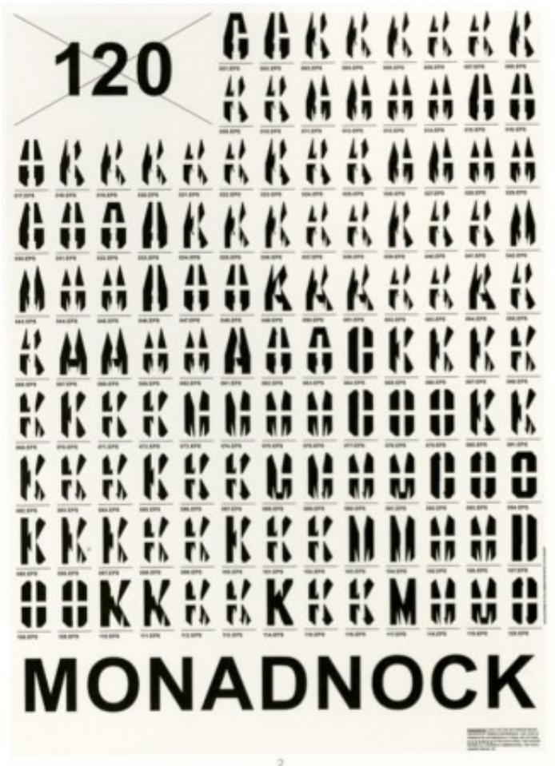

Catalogtree (in collaboration with Lutz Issler, programming), poster for logotype series for Monadnock, Rotterdam-based architects, 2007/2008. With each save, export or print command, the logo is automatically generated from a postscript file.

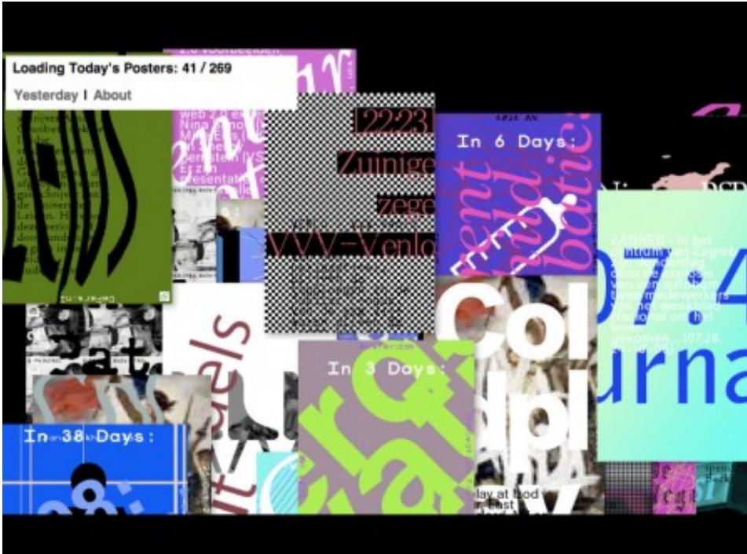

Lust, Poster Wall, Graphic Design Museum, Breda, the Netherlands, 2008. 600 unique posters are automatically generated daily using content gathered from various Internet sources.

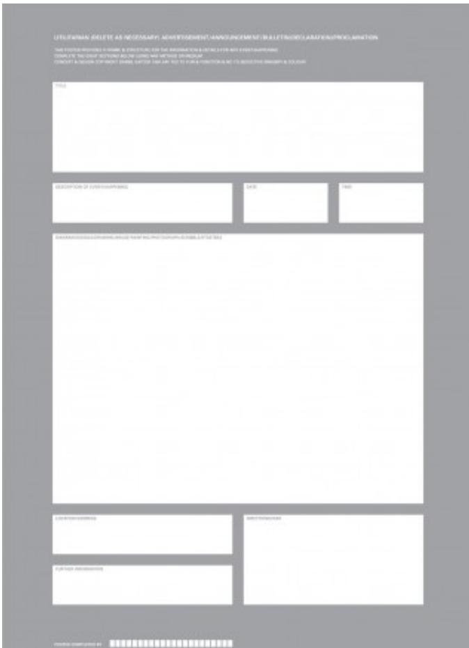

Daniel Eatock, Utilitarian Poster, 1998, foresakes the specificity of content and context, at least until the user completes it.

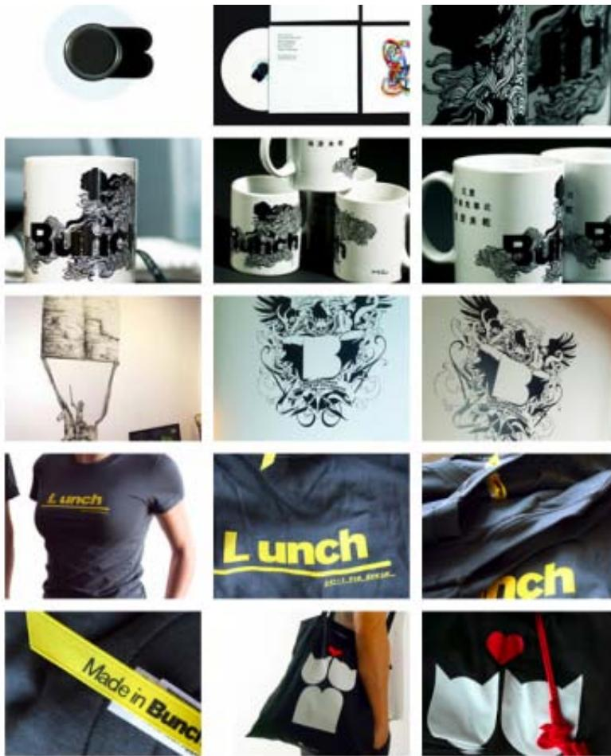

Identity for Bunch, a design firm, outsourced for re-interpretation to other designers, c. 2008

### RELATIONAL DESIGN...

• is not a movement or a style, per se, but rather a way of understanding, exploring, and reexamining the role of design and designers in the lifecycle of the artifacts that it produces.

• can be seen as a method or approach for the generation of form (i.e., design).

• represents a diverse range of practices across a variety of design fields and that diversity coupled with a more process-oriented approach means that common stylistic traits will not reveal such tendencies.

• although relational design is emergent with the advent of interactivity and connectivity in the digital realm, it is not limited to zeros and ones. However, it often uses such metaphors as an operational procedure.

• embraces constraints and conditions as opportunities not obstacles. It tends toward the reduction of subjectivity in the design process or transfers the subjective to others in the network of relationships.

• is only really complete within the confines of its immediate environment or context.
