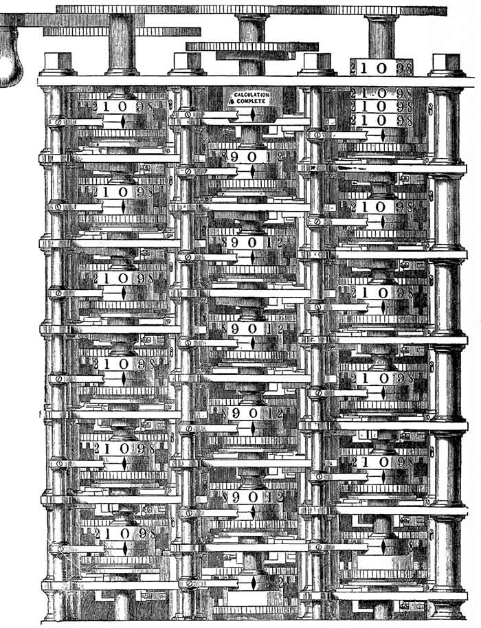
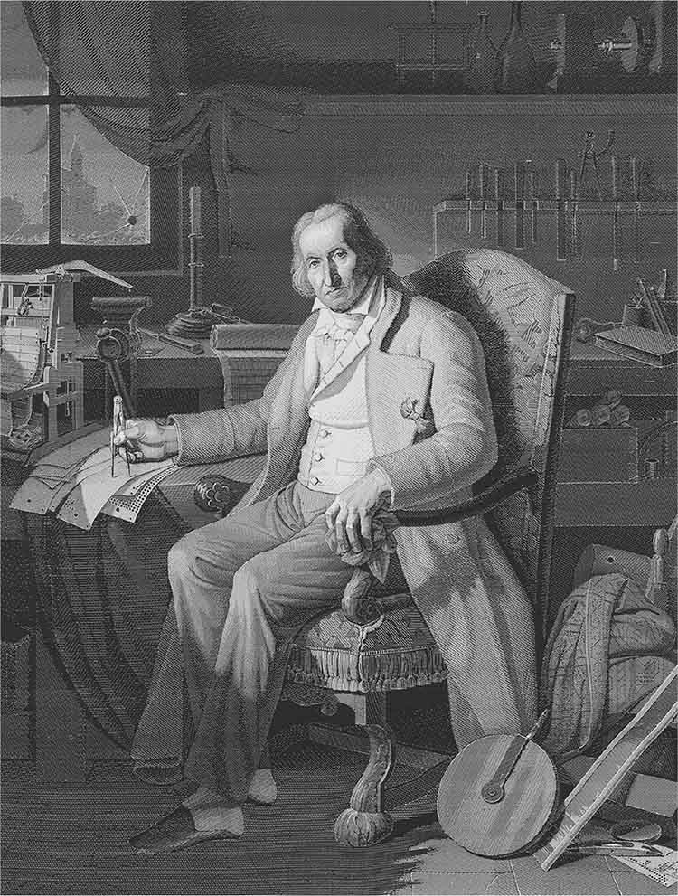
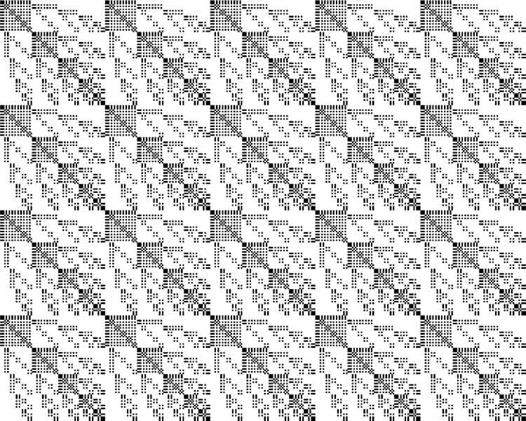
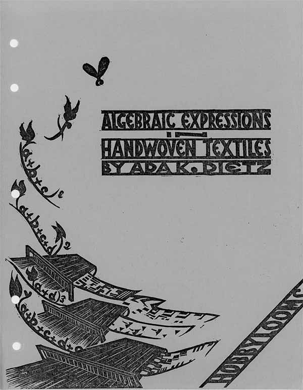
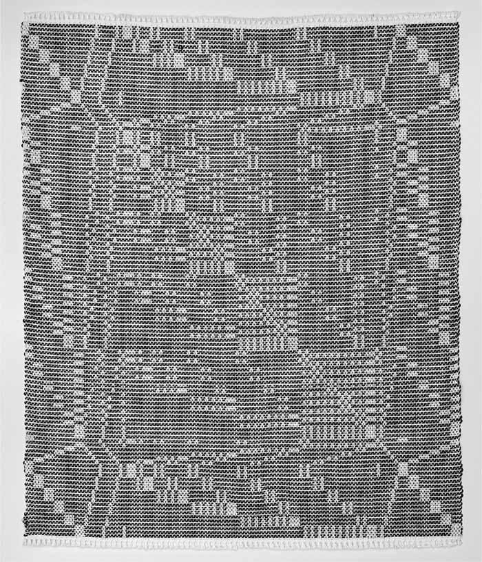

# Uncomputable - Weaving

Alexander R. Galloway

Uncomputable: Play and Politics In the Long Digital Age, Verso

***

PART II.

Weaving

6

Spider Work

Clytemnestra was lost by music. For it is said that when her husband, the general Agamemnon, left his Clytemnestra behind in search of glory at Troy, he stipulated that a Dorian musician—and no other—should remain behind in his wife’s chambers as a sort of prophylactic against any potential seduction. With Agamemnon abroad, Aegisthus came as a suitor to the lonely queen. At first the Dorian kept Aegisthus at bay through his song. Yet once Aegisthus discovered that the martial spirit of the music was conspiring to keep Clytemnestra true, Aegisthus slit the bard’s throat and claimed his prize, the queen no longer chastened by the Dorian mode.[^1]

If Clytemnestra was lost by music, Agamemnon was lost by webs and networks. In fact, the tragedy *Agamemnon* by Aeschylus contains some of the oldest depictions of networks, and hence some of the oldest examples of media systems in Western literature. In his play Aeschylus depicted two different types of networks. The first was an actual communications network, which was described in detail but remained off stage. The second was a mesh-work of traps, which while visible and present was but a symbol of larger machinations.

The actual communications network was a chain of fire beacons, spanning a few hundred miles, which carried the message of the fall of Troy back to Argos, and thus warned of the victor Agamemnon’s imminent homecoming. “Ida first launched his blazing beam; thence to this place / Beacon lit beacon in relays of flame” (lines 281–3), Clytemnestra explained, describing each of the dozen nodes in the overland communications chain.[^2] “They blazed in turn, kindling their pile of withered heath, / And passed the signal on” (294–5).

But later, upon the return of Agamemnon to his hearth, a second net was deployed, this one a “vast voluminous net” (1382) used by Clytemnestra—now in league with Aegisthus—to ensnare her husband and bring about his ruin. This voluminous net, later decried by the chorus as a “foul spider’s web” (1492) found form in a symbol: the sea of purple textile created by Clytemnestra and her weavers to adorn the threshold of the house, and upon which Agamemnon was eventually convinced to tread against his better judgment. With that silken step Agamemnon was, as Aegisthus gloated in the final lines of the play, “tangled in a net the avenging Furies wove” (1580) and his fate at Clytemnestra’s bloody hands was all but sealed.

Sensing that her wait was nearly over, the coy betrayer enticed Agamemnon with mock concern for his many rumored battle scars:

> Why, if my lord received as many wounds as Rumour,  
> Plying from Troy to Argos, gave him, he is a net,  
> All holes! (866–8)

Indeed, the image of the hero as netting, with his wounds representing the holes coming between each strand of the net, eventually materialized as his body was perforated three times in the play’s final scenes. Before it was recounted by Clytemnestra, the murder, and the weaponized net necessary for its consummation, was predicted first by Cassandra:

> There, there! O terror! What is this new sight?
>
> A hunting-net, Death’s weapon of attack!
>
> And she who hunts is she who shared his bed. (1114–16)

Webs and nets thus oscillate here between two related but incompatible formal structures. On one side, the chain of triumph; on the other, the web of ruin. In *Agamemnon* the chain of triumph is linear, efficient, and functional. It is contagious and additive as it moves. The lighting of one hilltop beacon does not dim or dilute the previous node but in fact compounds it. The chain of triumph is communicative and telepresent. It is directional. It follows a chain of command. It is constitutive of reality rather than destructive of it. And perhaps most evocative: the chain of triumph is made of pure energy. It is Iris and Hermes combined.

On the other hand, the web of ruin is none of these things. The divine referent is not Iris or Hermes, but the Furies. Less concerned with connectivity, the web of ruin brings with it a flood of insatiable persecution. Here the net is not a tonic, tethering together distant elements, but a solvent set on dissolving those ties. It is commonly characterized as a swarm, or a pack of animals, and is always unknowable in quality and innumerable in form. It is a nonlinear mesh, not a linear chain, designed to ensnare and delimit. Hence the web of ruin can always be deployed against the most intractable of opponents. So, while the first network of fire beacons runs in advance of the second, it is the second that undoes the first. Only Clytemnestra’s net can trap Ilium’s conqueror, eviscerating the house of Atreus.

In *Agamemnon*, the first play of Aeschylus’s Orestes trilogy, the Furies are only mentioned in passing. But in the third play, *The Eumenides*, the Furies return to saturate the narrative so fully that they are personified in an actual character, the chorus, but a character that can only be represented by a multiplicity of physical bodies. What were three in Virgil, these numerically variable divinities are twelve in Aeschylus (in Euripides they are fifteen). In tragedy, the chorus is generally a signifier for the social community. It is not a synonym for “the masses” or “the people” but simply the social “group.” This makes *The Eumenides* unusual, for what were stern, scolding elders in *Agamemnon* and clamoring female maidservants in the second play, *The Libation Bearers*, have in the third play devolved into a personification of vengeance itself, but in a nonhuman, which is to say divine, form. This is no longer the “group” but the swarm.

The web of ruin, symbolized in the first two plays by Clytemnestra’s various textiles—her weaponized nets and the purple sea of fabric, but also the tentacles of fabric forming the robe used to subdue Agamemnon like a straightjacket, what Orestes in *The Libation Bearers* calls “a trap, not of iron, but of thread” (493)—this web of ruin is no longer a symbol in the third and final play, but an actual incarnation of networked presence itself. In short, the Furies are the web of ruin personified. Hermes (as the chain of triumph) appears in *The Eumenides* too, if only for an instant. He shepherds Orestes in his travel link from Delphi to Athens. So, while Athena and the concept of justice certainly dominate the final play, the Furies indicate the lingering threat of networked forms of being, if not also networked vengeance.

The concordance between textiles and spider webs is noted also in Ovid with the story of Arachne, the haughty weaver maiden whom Athena transforms into a spider: “her hair and then her eyes and ears fell off, and all her body sank. And at her sides, her slender fingers clung to her as legs. The rest is belly; but from this, Arachne spins out a thread; again, she practices her weaver’s art, as once she fashioned webs.”[^3]

Arachne reappears in Dante as an allegorical figure for the poet himself, undone at the hands of his own artistic creation.[^4] The thread used to weave the pictorial textile becomes a noose with which Arachne tries to hang herself in defiance of the goddess. But the noose becomes a web again, referring back to the “spinning” of the artist, be it tales or tapestries.

If Clytemnestra used her textiles as weapons, Penelope also had a tactical relationship with the loom and her weaving. As Liddell and Scott describe it, Penelope was called by her name because of the *pēnē* \[*πήνη*\], the web that she wove.[^5] Or, more accurately, unwove, as Penelope alternated between weaving and unweaving as a way to manage and subdue her male suitors.

Penelope’s loom did not resemble modern draw looms, but rather stood up vertically, an upright frame where the warp yarns draped downward, held taut by weights at the bottom. Ancient Greek weavers could create a shed by pulling warp threads outward, and the weft was likely beaten upward from below, as opposed to the pulled beat of the typical hand loom. As Penelope wove, the fabric would have hung down vertically from the beam, like laundry.

The beam also furnishes a clue. For Penelope’s husband, Odysseus, was himself guiding a beam, only far away from home, his beam the mast of a ship, hers the mast of the loom. (The Greek *histós* \[*ἱστός*\] can mean both the mast of a ship, as well as the beam of the loom on which the warps are tied.) As classicist Marie-Louise Nosch put it, “The protagonist couple of the Odyssey, Odysseus and Penelope, each manipulate two large instruments all along the narrative thread: the ship and the loom.”[^6] And if Odysseus was in part defined by his mast—piloting it across the sea, being lashed to a mast before the Sirens, driving a beam through the eye of the Cyclops—Penelope too with her mast, Penelope the Weft Weaver who knew when to weave and when to unweave.

The web of ruin is thus also the ruin of the web, deciding to dissolve ties, if that be advantageous. For, while Penelope was synthesizing her weave by day, she was analyzing it by night, following the literal meaning of analyzing as “unloosening” or “unraveling.” And if weaving has always been a digital technology—as many will want to claim and I would certainly agree—Penelope indicates, with Clytemnestra as well, that the most digital act might not be that of sewing, or knitting, or synthesizing, or constructing, or erecting, but rather of unraveling, unloosening, deconstructing if not also destroying.

“Weaving … is perhaps less a contribution to civilization than its terminal decline,” wrote Sadie Plant on this kind of tactical usage of textiles.[^7] And, by the modern period, the textile industry with its power looms, spinning machines, and knitting machines became the site of “networked vengeance,” both the subduing and exploitation of women (along with men and child workers), as well as resistance to it. Perhaps this is why textiles and weavers play such an important role in Marx’s *Capital*, from his elementary examples involving “our old friend the linen weaver” with his twenty yards of linen being exchanged for one coat, to Marx’s extended investigations into the experience of textile labor during the working day, how it corrupts the life world of spinners, knitters, and weavers, driving them to starvation and despair.[^8] “World history offers no spectacle more frightful than the gradual extinction of the English hand-loom weavers,” wrote Marx.[^9] Of particular importance was the gendered division of labor. Marx quoted the social reformer Lord Ashley, who had testified that a certain manufacturer “employed females exclusively at his power-looms,” preferring married over unmarried women, since, according to the shop owner, married women were “attentive, docile … compelled to use their utmost exertions to procure the necessaries of life.”[^10]

New inventions such as mechanical knitting machines (known as “frames” or “stocking frames”), or the automated draw-boy loom patented by Joseph Marie Jacquard in 1805, put new pressures on labor, and incited new kinds of resistance to the machines. “Jacquard’s invention was an efficient means of economizing on labour” wrote textile historian Agnes Geijer. “One can therefore readily understand how the many poor silk weavers of Lyons (*les canuts*), feared for their livelihoods. Serious rioting broke out on Jacquard’s return to Lyons, the new loom was publicly burned and Jacquard himself had to leave the city.”[^11]

“Not twelve hours elapsed without some fresh act of violence,” testified Lord Byron in 1812, after touring the knitting mills of Nottinghamshire. “On the day I left the county I was informed that forty frames had been broken the preceding evening, as usual, without resistance and without detection.”[^12] Himself somewhat seduced by the motivations of the frame breakers, Byron noted the hardship and plight of those knitters and weavers newly unemployed by the machine. Yet industrialization offended Byron’s aesthetic sensibilities most of all, for the new mechanized fabrics and garments were “inferior in quality,” he proclaimed. And this machine-made textile, an impoverished garment for an impoverished body, “was called, in the cant of the trade, by the name of ‘Spider-work.’ ”[^13]

7

The Crumb Machine

Weaving is quite old, as we have seen. It is also international, with the Chinese silk industry exerting great influence historically, along with the tapestries and rugs of central and southern Asia, and the many dyes and textiles sourced through colonial networks and the exploitation of minerals, plants, and people. Much reverence is reserved for Andean weavers in the area of Peru, whose skill was unmatched. For instance, Anni Albers, the protégé weaver of the Bauhaus, who would help insinuate weaving into the rarified confines of modern art, dedicated her influential book *On Weaving*, the culminating statement of her life’s work, to “my great teachers, the weavers of ancient Peru.”[^14]

As to when and how weaving became enmeshed with computation, the explanation is both startlingly obvious and stubbornly elusive. Since 1953 at least, with the publication of B. V. Bowden’s *Faster Than Thought*, pride of place has been given to one Ada Augusta, Countess of Lovelace (a.k.a. Ada Lovelace, daughter of the aforementioned Lord Byron), and her pivotal role in the development of calculating machines.[^15] For it was Lovelace who understood the power of the Jacquard punched cards, which Charles Babbage had grafted onto his calculating “Engine” in three places. And it was Lovelace who wrote the most sophisticated gloss of Babbage’s Engine, and who itemized a sequence of operations that one might execute on that machine, thereby writing a kind of “software.” By 1977 computer scientist Herman Goldstine would, without hesitation, refer to Lovelace as “the world’s first programmer.”[^16]

Yet here I will ape the argument of Ellen Harlizius-Klü ck, that although it is common to trace computation back to Babbage and Lovelace, and through them to the Jacquard loom with its punched cards and automated draw-boy, the narrative of “Jacquard as origin” belies the fact that weaving has always been a digital art, and thus Jacquard or Lovelace are not the beginning of a story so much as its culmination.[^17] And, if Jacquard did not make weaving computational—surely it was that already—Jacquard did in fact *compress* the digitality of weaving. Since, instead of dancing atop multiple treadles, the Jacquard loom reduced the weaver “to an operator who had to step on a single treadle repeatedly.”[^18] And so, with Jacquard, the multiple devolves back down to the one.

**Figure 8.** Woodcut depicting Charles Babbage’s Difference Engine No. 1. Source: Charles Babbage, *Passages from the Life of a Philosopher* (1864), frontispiece.

That is one shortcoming. And here is another: Babbage’s machine never even existed, except on paper. The so-called invention of the computer was thus also the invention of vaporware, the promise of a device to come that does not yet exist. In fact, “the mechanisms forming the historical line culminating in the one from Jacquard are all more or less failures,” Harlizius-Klü ck stated dryly,

> stored in collections devoted to tinkering mechanisms of inventors like Vaucanson’s duck or his androids. On the other hand, we have the cheap, self-made, working and therefore outwearing mechanisms with untranslatable names invented and used by nameless regional weavers for weaving strange-named fabrics like *Kölsch* or *Schachwitz*. Such tools do not enter the collections of national museums as long as they are in use, and afterwards they hardly ever survive.[^19]

Instead of Babbage, Jacquard, or Vaucanson, shall we not instead praise the many nameless weavers who stored energy in their bodies and stored patterns in their fingertips? *Worn out* and forgotten, they are still nevertheless *worn*. We wear their handiwork to this day, textile as media, and media as memory. Perhaps this is why Albers considered weaving a bona fide form of writing, naming her weavings with titles drawn from the world of language, titles like “Code,” “Memo,” “Haiku,” “Epitaph,” “Ancient Writing,” or “Pictographic.”[^20]

Let us then praise the nameless artisan who built the Crumb Machine (*Bröselmaschine*). As Heinz Zemanek recounted the story, “Professor Adolf Adam has discovered in a weaving museum in Upper Austria near the three-country corner of Germany, Bohemia, and Austria a weaver’s programming device built in 1740, but in all probability invented between 1680 and 1690.”[^21] Housed today at the Museum of Weaving in Haslach, Austria, the Crumb Machine predates the Jacquard system by many years, but uses a similar technique. Wooden pegs or “crumbs” are encoded on a conveyor belt, not unlike a musical score for a player piano or music box. The pegs rub against an array of wooden fingers, displacing the fingers in a given pattern, engaging certain heddles while leaving others at rest. The weaver actuates a lever, which opens the warp shed in accordance with the engaged heddles. As different patterns of crumbs move through the head of the loom, different patterns are woven into the fabric.

What were crumbs at the start of the eighteenth century became holes by the end of it. The Jacquard weaving system had a number of important antecedents in other industrial devices along the way, including machines made by Basile Bouchon and Jean Philippe Falcon. It was Bouchon in 1725,

> who had the idea of eliminating the hodgepodge of cords and knots, replacing it with an assortment of needles and hooks, which would be depressed or released by virtue of holes punched in a long paper band … This idea was soon modified by Falcon around the year 1734, who replaced the paper with rectangular, punched cards, laced together in series as we see them today.[^22]

Jacquard did not invent a new loom so much as rediscover and recombine existing techniques into a new system. In fact, much of the loom remained essentially untouched from the old hand looms; only the mechanism for raising and lowering warp threads was modified.

Large looms would employ a primary weaver at the front, but frequently also an assistant, the so-called “draw-boy,” who would scramble up to a perch on top of the loom, drawing up the loom’s many strings like a puppeteer. But what were two weavers working on the same loom soon became one, as Jacquard (like others before him) sought to eliminate the draw-boy, replacing him with an automated set of brains and fingers. The Jacquard system was first and foremost a supplementary machine grafted on to the existing loom. The automatic draw-boy added a new control mechanism overhead. But migrating to the draw-boy also meant that certain existing features of the loom could be discarded, such as multiple lamms and foot treadles, typically in favor of a single treadle for on and off positions: engage the draw-boy, disengage the draw-boy.

Older automated looms, like the silk looms of Philippe de Lasalle, had rigged up various mechanical apparatuses to achieve a similar result, but Jacquard’s new automated draw-boy appealed to those seeking greater efficiency and elegance in the industrial process:

> The old loom took up considerable space due to the volume of the paddles and the semples. It couldn’t be moved without disturbing the rigging. The Jacquard loom, with an elegant and useful design, lends itself to any arrangement without the least inconvenience. The old loom was weighed down with pulley systems, paddles, and semples, etc. The new one is totally freed of this paraphernalia.[^23]

As with the Crumb Machine, the essence of the draw-boy was a mechanism by which an encoded substrate—whether pegs on a belt or cards punched with holes—could be “read” in sequence, actuating the raising and lowering of heddles to create specific weaving sheds. Here matter comes in contact with information. Of course, it was prone to failure. Writing in the mid nineteenth century, Paul Eymard recounted his memory of the machine, particularly how difficult it was to get the encoded cards to engage correctly:

> It is true that incorporating the carriage was a difficult task: It struck too hard or too softly; sometimes it arrived too late, sometimes it arrived too early, would bounce and do damage to the cards … \[M\]ounted on four castors, the carriage would easily juggle left or right a small amount, enough to keep the cards from landing flush. What’s more, it made an enormous racket. I remember how Mr. Dutilleu and my father, both manufacturers back in that period, would speak of it: each time the cylinder turned they would close their eyes like it was an explosion.[^24]

Yet Jacquard had the personal blessing of Napoleon, along with a commission from the Society for the Promotion of National Industry, and with the help of new money coming in, Jacquard had built fifteen of his looms by 1805, and twenty-six by May 1807.

The Jacquard looms moved across the English Channel as well, and Babbage likely encountered them in 1823 when he toured factories in England and Scotland: “Babbage had been making the most detailed study of industry,” wrote biographer Anthony Hyman, “touring the country to visit factories, inspecting every machine, every industrial process he could discover.”[^25] Biographer Betty Toole states that Babbage adopted his punch card system from Jacquard. At the same time, Ada Lovelace and her mother, Lady Byron, also recognized the utility of the loom as a kind of proto-computer.[^26] In 1834 the pair “embarked on a tour of the industrial heartland of northern England, visiting many factories and seeing with their own eyes the immense potential of machinery. They saw a Jacquard loom in action, and Lady Byron even drew a picture of a punched card used to control the loom’s operation.”[^27]

While equating computer to loom is a seductive way to rethink media history, it is clear that Babbage’s own metaphor was *engine*, not loom or some other device, thereby associating his machine with the steam engine, the railroad locomotive, and the various mechanical engines of the early nineteenth century. Both Babbage and Lovelace spoke of “the Engine,” never “the Loom.”[^28] At the same time, Babbage borrowed organizational and architectural terminology from textile factories, two terms in particular, *store* and *mill*. In Babbage’s machines, the store was something like the memory or storage, the place where numbers could be held in reserve, following the analogy of yarn held on shelves in a factory’s storehouse. The mill was what would today be called a central processing unit (CPU), the mechanism for carrying out numerical operations, just as a millstone would grind grain or a shuttle and reed would weave yarn.[^29]

Lovelace also pushed the loom analogy, referencing Jacquard a few times in her famous “Notes,” as in the following passage, the most frequently quoted line penned by Lovelace:

> The distinctive characteristic of the Analytical Engine … is the introduction into it of the principle which Jacquard devised for regulating, by means of punched cards, the most complicated patterns in the fabrication of brocaded stuffs … We may say most aptly that the Analytical Engine *weaves algebraical patterns* just as the Jacquard-loom weaves flowers and leaves.[^30]

To weave algebraical patterns—Babbage was enamored by a small 20 x 14-inch silk weaving in his possession ([figure 9](#fig9)), which he would display to visitors at his home. The weaving was in fact a finely wrought portrait of Jacquard, a sort of display piece to demonstrate the kind of realistic detail furnished by Jacquard’s system. Owing more to the traditions of painting or lithography than weaving, or if textiles then the pictorial tradition of tapestry weaving, the portrait was machine woven in silk yarn, requiring a staggering 24,000 punched cards for its production.[^31] The portrait depicts an old man dressed in fine clothes, sitting in an ornate, well-upholstered chair. Workshop paraphernalia appear around him: chisels, compass, vice, bottles, rolls of plans in a drawer. Jacquard is holding calipers over a stack of punched cards; he seems to be measuring or comparing sizes. Also present are various weaving implements, including a reed and shuttle, along with festoons of fabric, and a scale model of Jacquard’s automated draw-boy.

**Figure 9.** Didier-Petit & Co., “À la mémoire de J. M. Jacquard” (detail), 1839. Source: Library of Congress Prints and Photographs Division, Washington, DC, USA.

Babbage had one of the silk portraits already but he wanted a second. On a trip to Turin in Northern Italy in 1840, he stopped along the route in Lyon to spend a few days at the textile mill of one Didier-Petit and Co. of Quai de Retz, no. 34, where the silk portrait had been made. “I was especially anxious to see the loom in which that admirable specimen of fine art, the portrait of Jacquard, was woven,” he recalled later in his autobiography. “I passed many hours in watching its progress.”[^32]

Babbage’s 1840 trip to Turin would prove historic, since it put in motion a series of events culminating in Lovelace’s “Notes” a few years later. In Turin Babbage had convinced the Italian mathematician Luigi Federico Menabrea to draft a text describing his yet unbuilt Analytical Engine. After the publication (in French) of Menabrea’s text, Lovelace proposed to translate Menabrea’s text into English, which she did, while also glossing it (and, through it, Babbage’s engine) by means of a series of extensive endnotes. These notes included interesting commentary on the design and use of Babbage’s engine such as the technique of running backwards in repetition to create loops of operations, as well as the famous “Note G,” in which Lovelace described a sequence of specific operations on Babbage’s engine—essentially an algorithm—by which to compute Bernoulli numbers. (Bernoulli numbers are a sequence of rational numbers important in analysis and number theory.)

The textual chain is nothing if not intricate. If Lovelace wrote the world’s first “software,” she did so in an endnote, to a translation, of an article, about a machine—a machine that did not yet exist! I suspect that this magnifies rather than diminishes the significance of Lovelace’s efforts.

Sadie Plant and others have commented on how Lovelace’s contributions to Babbage’s engine were largely para-textual, and thus emblematic of women’s work more generally. Here was Lovelace, acting as a kind of female secretary, drafting auxiliary endnotes for a man’s hardware.[^33] Yet Lovelace’s seeming marginality, upon closer inspection, reveals a whole series of interesting insights. I will merely highlight one of them, the technique of *backing*.

Admiring Jacquard’s system, Lovelace nevertheless determined that Jacquard’s use of punch cards “was not found … to be sufficiently powerful for all the … varied and complicated processes as those required in order to fulfil the purposes of an Analytical Engine.”[^34] Seeing this shortcoming, Lovelace’s solution was labeled “backing,” that is, rotating the Jacquard prism backward to access previous cards in the pattern sequence. “The prism then resumes its *forward* rotation, and thus brings the card or set of cards in question into play a second time.”[^35] In this way, sequences of cards could be repeated, creating multiple iterations and loops. In the parlance of today’s computer science, Lovelace’s “backing” would be called a control structure.[^36]

Lovelace even suggested that this “backing” technique could be reintroduced into Jacquard looms to great advantage: “By the introduction of the system of *backing* into the Jacquard-loom itself, patterns which should possess symmetry, and follow regular laws of any extent, might be woven by means of comparatively few cards.”[^37] In essence she was thinking about how the cards represent snippets of operations that could, like patterns or phrases of text, be taken out of context, looped and repeated, an activity that weavers already understood intuitively.

The centerpiece of Lovelace’s celebrated “Note G” was a table of instructions. And Lovelace used the principle of backing (looping) there to practical effect. “The table is what computer scientists would now call an ‘execution trace,’ ” wrote one historian, meaning it documented the state of the machine as it changed through a series of performed operations.[^38] An execution trace, it also resembled what weavers call the treadling sequence of draft notation.

“The draft notation is something like an image of practice,” wrote art historian T’ai Smith. “It tells us not how the textile will *look* so much as … the technical operation through which it is made … It is something of an algorithmic code-as-image.”[^39] Lovelace was, in a sense, writing draft notation, treadling the Engine, just as a weaver would treadle a loom. And her notation reveals the essence of algorithms: one part encoded pattern (from the textile loom), and another part kinetic motion (from the steam engine).

8

Regular Irregularity

From one Ada to another, leap forward one hundred years from London circa 1840 to Detroit, Michigan, in the early 1940s. There Ms. Ada K. Dietz, a school teacher on the verge of retirement, soon to turn sixty years old, no children and never married, decided to change her life and begin again. On the suggestion of her close friend Ruth E. Foster, Dietz enrolled in a weaving class offered at Wayne University (today called Wayne State University), to study textile art under the tutelage of Nellie Sargent Johnson, a veteran weaver and prolific author and publisher on the subject. Quickly excelling at the craft, Dietz would soon leave her life behind, the job she held at Eastern High School since 1912, the school from which she herself had graduated in 1908, her Sigma Theta sorority sisters from the University of Michigan, her women’s leagues and bridge games, trading in the Midwest for sunny California. Once out West, in close collaboration with Foster, Dietz would go on to create her own approach to designing draft patterns for textiles, an unusual technique based on translating simple algebraic expressions into two-dimensional patterns of interlaced warp and weft.[^40]

A number of colorful stories help fill out the life of Ada Dietz. Born October 7, 1888, the daughter of a cigar manufacturer, Dietz seemed to have had a comfortable upbringing in the lively Detroit of the turn of the century. Keen on science, she studied plant ecology at the University of Michigan, where, while traipsing through the bogs around Douglas Lake, she discovered “a mosquito bearing on its head two small yellow masses that looked like pollen,” demonstrating the insect’s role in the pollination of orchids and earning Dietz a commendation in *Science* magazine.2 Upon graduation, Dietz went to work almost immediately as a teacher, first at Central High School in the spring of 1912, where she played center on the faculty basketball team, before switching to her alma mater Eastern High School in the fall of 1912. Hired at Eastern as an assistant physical geography teacher, Dietz had to work out of what was formerly a teacher’s lounge, the room recently having been converted into classrooms in order to handle excess student enrollment. Dietz would eventually become a teacher of biological sciences and mathematics, and also serve as a school counselor, teaching at Eastern for thirty years. She directed the high school orchestra during graduation ceremonies, was head of the “dancing committee” at the school carnival, and in her free time was devoted to any number of women’s groups and society shindigs.

Basketball, orchestra, bridge, biology—Dietz had yet more experiences ahead of her, sparked by her friendship with Ruth Foster. Both spinsters, both school teachers, Foster and Dietz had become friends by at least 1941 and possibly earlier. A complementary pair—Foster taught art, while Dietz taught math—Foster was living in California, where she taught at Polytechnic High School in Long Beach, California. An interest in textiles had led Foster to study weaving at Wayne University as well as at the Cranbrook Academy of Art in Bloomfield Hills, Michigan, twenty miles north of Detroit. By the mid 1940s, Foster had convinced Dietz to take up weaving as well, and, more importantly, had convinced her to retire from teaching in Detroit and come to live with Foster in her “pleasant bungalow” in Long Beach.[^41]

“In a sunlit hobby room opening on a charming patio, a mathematician and an artist happily combine their talents to produce textiles of originality and beauty,” was how one journalist described Foster (the artist) and Dietz (the mathematician) in their California weaving studio. “In their cheery hobby room with its walls tinted in a delicate shade of green, where looms of many sizes occupy the floor spaces, there are drawers filled almost to overflowing with yarns and threads in a riot of shades and colors like Joseph’s coat.”[^42]

Dietz and Foster decided to go in together as artisans and collaborators. Under the informal trademark “Hobby Looms,” they began to weave together, “Miss Dietz drafting mathematically and Miss Foster grasping the picture it presents and translating it.”[^43] They divided up the various steps of the weaving process. Foster “planned many of the colorings and textures,” while Dietz being more left-brained tackled the analytical and technical aspects of drafting the weave.[^44] Along with some small table looms, one of which was nicknamed “Mary Jane,” they had a large countermarch loom—likely the four-shaft Leclerc Fanny loom or a similar model—which they affectionately christened “Brunhilda,” after the Valkyrie queen from Norse mythology. They also had a small Heinz terrier named Pickles.

These two intrepid weavers set out on a series of long road trips between 1946 and 1952, along the way developing a unique series of textile designs at the intersection of weaving and computation. The crucial breakthrough seems to have arrived at the end of a multiday drive from Long Beach, California, up to Banff, Canada. Dietz and Foster “were driving north to study at the Banff School of Fine Arts in Canada under Mrs. Ethel Henderson and Mrs. Mary E. Sandin.”[^45] And it was in the summer of 1946, “in the clear cool air of Alberta, that Miss Dietz conceived the idea of using algebra as a basis for patterns.”[^46]

Most weavers rely on tacit knowledge of basic patterns like point twills or overshot techniques, or might refer to draft books for documentation on more complex weaves. At the same time, a weaver might wish to experiment with new patterns, changing the arrangement of threads through the loom’s harnesses, the vertical frames used to raise and lower warp threads, as well as the sequence in which the harnesses are moved, called a treadling sequence. Dietz began to focus on these kinds of threading patterns. In the three most basic weaves, plain weave, twill, and satin, the warp threads running lengthwise through the loom are raised and lowered in small repeated patterns, while the crossing thread, the weft, is passed back and forth using a shuttle. In these basic weaves, the threading patterns are also rather straightforward: warp yarns are threaded through the loom harnesses in regular succession. I suspect it was this regularity that piqued Dietz’s interest—or perhaps the somewhat arbitrary nature of the regularity—since she began to develop new ways to generate patterns. Instead of a simple 1-2-3-4 threading pattern, then back again to 1-2-3-4, and repeating width-wise across the textile, Dietz began to spin out more complicated phrases of integers, repeating not after 4 threads but after 16, or 240, and ultimately 504 threads.

Dietz found her pattern generator in algebra, in that very thing she had taught for so many years in Detroit. From her past experience as a teacher, Dietz knew how common polynomial expressions like (*x* + *y*)[^47] were in fact a means of expressing patterns between numbers. If she could simply expand the expression in long form, and if she could translate the resulting pattern to the loom, she would, in effect, have devised her own pattern generator, a kind of algorithmic draft pattern for weaving. What’s more, her technique, if it were successful, would not simply furnish one or two new patterns, but a seemingly unlimited number of weaving drafts, based on the many combinatorial possibilities of algebraic expressions, from squares to cubes, from two variables to three, and beyond.

By early summer 1947, Dietz had woven eight samples based on rendering a series of different formulae ([figure 10](#fig10)). She wrote to her former teacher, Nellie Sargent Johnson, to describe the technique. “First I tried the ‘Cube of a Binomial,’ ” she explained to Johnson. “When woven I found the proportions were pleasing, and I liked its regular irregularity.”[^48]

**Figure 10.** The polynomial (*a* + *b* + *c* + *d* + *e* + *f*)2 rendered using Ada K. Dietz’s technique. Source: Ralph E. Griswold, “Design Inspirations from Multivariate Polynomials, Part 1” (2001).

In fact, it was an even more complex design from the square of a polynomial in six variables expressed as the formula (*a* + *b* + *c* + *d* + *e* + *f*)2 that would eventually furnish Dietz the “regular irregularity” she so desired. In 1948, Dietz and Foster sent three entries to the summer country fair held at the Little Loomhouse in Louisville, Kentucky, where they took blue ribbons for their textiles. The director of the Little Loomhouse, Lou Tate, was so taken by the new weavings that she asked Dietz to assemble an exhibition and to begin work on a booklet explaining the various drafts and weavings, eventually published in 1949 by the Little Loomhouse under the title *Algebraic Expressions in Handwoven Textiles*.[^49] (The pamphlet is attributed to “Ada K. Dietz,” however Ruth Foster is acknowledged as a collaborator, and much of the text itself seems to have been compiled and written by Tate and others at the Loomhouse, based on notes and diagrams provided by Dietz.)

Buoyed by interest in their work, Dietz and Foster hit the road to share their wares. They “motored to Louisville this summer \[1948\] to see the Little Loomhouse … From there they went on a 10,000-mile tour that took them as far north as Toronto, Canada. They went wherever they heard that somebody was doing interesting things in weaving.”[^50]

Back home in California, they continued weaving, assembling a “traveling exhibit of more than 30 handwoven textiles,” many of them based on Dietz’s algorithmic designs.[^51] By late 1951 or early 1952, they embarked on another big trip. “They bought a trailer, locked the doors of the Long Beach studio, and started out to see what was going on in handweaving elsewhere.”[^52]

First stop again was the Little Loomhouse in Louisville, “where plans for the future of the exhibition of ‘Algebraic Expressions in Handwoven Textiles’ were discussed.”[^53] This was followed by nine weeks back home in Detroit, including a “visit to Mrs. Alpaugh’s lake shore home, designed by Frank Lloyd Wright,” before subsequent stops in Rochester and Saranac Lake in New York state.[^54] Continuing on to Bangor, Maine, they left the trailer stateside before crossing over to Canada to visit the Leclerc loom factory in L’Islet Station, Quebec. The Leclerc factory was “just then being rebuilt after a disastrous fire” on February 9, 1951.[^55] Continuing eastward, they sampled the weavings of New Brunswick and Nova Scotia, before returning back southward to Boston, down the Eastern Seaboard for three months in Florida, eventually returning home via Houston and San Antonio. During this year-long odyssey, they visited homes of friends, women’s groups, and weaving clubs. They parked their trailer in RV parks, took Pickles out for walks, and set out their looms and textiles on display to make for an easy conversation starter.

The two had quickly outgrown their old weaving studio in Long Beach. They decided to knock out a wall to enlarge the space, and to fill it with better natural light. “Now this sky-lighted, window and French-door lighted room, combining workmanlike air with an artistic flair, is the heart of the house.”[^56] And if mathematics shares something with weaving, it certainly also has a special relationship with music, and when “Miss Dietz goes to work … the result is something like a bar of music, and from it she ‘plays’ a ‘tune’, a melody of color and design on her big loom she calls Brunhilda.”[^57]

9

Algebraic Weaving

“The idea is too new, too exciting, too varied, too unexplored to tie down,” wrote master weaver Lou Tate on the draft patterns devised by Ada Dietz in the late 1940s.[^58] They were also tedious and obtuse, with even one of Dietz’s simplest mathematical expressions expanding out to the rather inscrutable pattern:

*xxxxx y xx y xx y x yy x yy x yyyyy*

The trouble with pattern is that it needs a rationale. Why is one pattern used in place of another? Sometimes the answer is found in practice and use, what this or that pattern will generate in terms of its drape or its texture. Sometimes it is simply a matter of taste, when someone prefers one pattern over another. But often, pattern is more or less arbitrary, as there are any number of ways to weave a twill, and in any case patterns come and go with the passing fashion.

By her own admission, what Dietz sought was “a reason for writing a draft in a definite way.”[^59] She wanted “the most definite basis from which to work.”[^60] And Dietz found her definite basis in the geometric patterns generated by simple algebraic formulae such as the cube of a binomial, (*x* + *y)*3, or the square of a trinomial, (*x* + *y* + *z)*2. Having taught the binomial theorem to hundreds of high school students over her long teaching career, Dietz put the theorem to work in her weaving as well. Using the binomial theorem, Dietz wrote out the expansions of various algebraic expressions. For instance, the squared binomial (*x* + *y)*2 expands to the equivalent expression *x*2 + 2*xy* + *y*2. Then, departing from algebraic rules, Dietz migrated this pattern further into a strict alternation between the two variables, so *x*2 + 2*xy* + *y*2 became *xx xy xy yy,* or when fused together, *xxxyxyyy.*

Dietz’s technique was, in fact, half algebra and half creative patterning. “Although the procedure described \[by Dietz\] is not mathematically sound,” the computer scientist and weaving enthusiast Ralph Griswold noted, “it is unambiguous if somewhat arbitrary.”[^61] Griswold referred to these sorts of pattern strings as “Dietz Polynomials,” calculating that a rather large Dietz Polynomial with 9 variables raised to a power of 6 would generate a pattern 3,188,646 characters long, which, using Dietz’s normal loom dressing technique and a yarn sett of 30 ends per inch, could weave a nonrepeating fabric pattern over three miles wide!

Dietz’s experiments using algebra to generate threading patterns, along with detailed instructions for the home weaver, were ultimately collected in her rather remarkable 1949 pamphlet *Algebraic Expressions in Handwoven Textiles.* An unusual publication in several ways, one might comment first on its cover, a block print by Dietz’s collaborator Ruth Foster ([figure 11](#fig11)). A bold heading rendered in arts-and-crafts lettering announces the title and author. At the bottom right appears the brand of “Hobby Looms,” the two women’s collaborative moniker. Butterflies and leaves adorn a cascade of algebraic expressions—at Dietz’s preference, two-, three-, four-, and five-term polynomials—which seem to float down from the great beyond, slotting into the side of three simple hand looms, like input for a computer. Off to the right side of each loom spills a ribbon of fabric, decorated in geometric patterns reminiscent of Bauhaus weavers like Gunta Stölzl. The orientation here is all wrong, of course, but no matter: patterns, if they come from anywhere, might come from above, as in the Jacquard draw-boy, or below, from the feet in a treadling sequence, and fabric when it is woven doesn’t spill out rightward from the loom but moves frontward toward the weaver, collecting on a roll near one’s knees. Nevertheless, this is a compelling illustration, and it sums up the project well. Equations go in, and fabric comes out.

**Figure 11.** Ada K. Dietz, *Algebraic Expressions in Handwoven Textiles* (Louisville, KY: Little Loomhouse, 1949), cover block print by Ruth Foster.

At the same time, Foster’s illustration bears an uncanny resemblance to the computing machine defined by Alan Turing in 1936. (This is not surprising, given how the computer is, in some senses but not in others, already a remediation of the textile loom.) In both devices, a scrolling medium passes through a central processing mechanism that manipulates the scroll according to mathematical rules.

“Insofar as weaving reproduces a binary logic (the alternate interlacing of warp and weft threads),” observed T’ai Smith, “woven patterns and structures are essentially manipulations of algebraic equations.”[^62] Having generated her basis patterns (for example, the squared binomial pattern *xxxyxyyy*), Dietz would then pivot to the loom to map the pattern onto the various mechanisms involved in weaving. Today’s computer artists are familiar with the notion of a “data conversion,” where a data source (of whatever kind) is interpreted as the input for some kind of visualization. Sometimes the data source matters a great deal, as when bodies are scanned or when labor is extracted. Other times, the source of the data matters less than the pattern or behavior it transcribes; a stochastic input, for instance, might trigger certain behaviors in a game or simulation.

Dietz did something similar in the late 1940s on her loom. She took the various algebraic patterns as input and mapped them onto how the warp yarns were threaded through the harnesses of the loom. (Although the patterns could also be interpreted in different ways, in, say, the alternations of the colors of warp yarns.) For instance, Dietz might define *x* to mean “one yarn through harness A and another yarn through harness B,” while *y* might indicate “yarns through harnesses C and D.” Preceding in this manner, Dietz would dress her loom following whatever *x* or *y* threading the pattern dictated. Instead of a simple twill threading repeating after four or eight threads, Dietz’s threading patterns were a bit more complex, in the case of the simple squared binomial repeating after 16 warp ends, and much longer in some of her more sophisticated weavings.

Dietz experimented with all sorts of different equations in the late 1940s. She also tried different styles of weaving, preferring most frequently overshot weave, crackle weave, and summer-and-winter weave. Many of her patterns could be woven in different ways, and she documented several of the combinations in the 1949 pamphlet. Each textile was assigned a special code of the form “AKD-3-2-O” or “AKD-3-3-PW.” The prefix referred to Dietz’s initials, followed by the number of variables in the polynomial and the power of the equation. Thus “3-2” meant a trinomial raised to the second power, and “3-3” meant a trinomial raised to the third power. The final letter indicated the type of weave, “O” for overshot, “PW” for plain weave, and so on.

Of the initial set of samples woven using this technique, many viewers were entranced by one in particular, Dietz’s most sophisticated textile, a six-term polynomial to the second power dubbed “AKD-6-2-SW” ([figure 12](#fig12)) and defined using the expression (*a* + *b* + *c* + *d* + *e* + *f)*2. “It was the ‘panel on a six-term polynomial in summer and winter weave’ that claimed everyone’s attention,” wrote one observer.[^63]

**Figure 12**. Ada K. Dietz, “AKD-6-2-SW,” c. 1947 (reproduction 2020).

While she frequently worked on a four-harness loom, here Dietz needed to incorporate more variables. To accommodate the six unknowns, she switched to a larger loom with eight harnesses. She also elected to weave in the “summer-and-winter” technique, which relies on a basic 8-thread block (4 pattern picks plus 4 tabby picks) and builds up patterns by diverting these blocks toward the front or the back of the fabric, effectively turning them on or off like a block of “pixels.” If a contrasting colored yarn is used in the pattern weft, it becomes possible to draw simple graphical and even pictorial patterns. Dietz dressed her loom with 504 warp threads in this nonrepeating pattern. “Rarely did Miss Dietz use the same weft as the warp for her background yarn,” observed Lana Schneider, who had Dietz’s techniques handed down to her through a mutual acquaintance and wove her own Dietz samples. “More frequently, she used yarn that contrasted with the pattern yarn, often with added texture in a very fine thread.”[^64] For AKD-6-2-SW, Dietz selected a soft yellow pattern color, which contrasted well with the navy blue yarns used for the warp and tabby weft.

“Like a cubist’s dream!” was one viewer’s reaction to AKD-6-2-SW, although the art historians would likely disagree.[^65] Nevertheless the weaving is striking in its composition. The pattern orients around the diagonal axis, an artifact stemming from how Dietz treadled the weave following the same pattern as the threading, allowing the weft to mirror the warp. At the edge of the textile, a broad border pattern wraps the composition on all four sides. At the center the pattern becomes almost fractal, with blocks increasing proportionately in size along the diagonal, spinning off tendrils in their wake. Overall, the weaving is beguiling if not also slightly disorienting. A woven textile, nevertheless this fabric does not resemble the many commonplace twills or even more complex overshot or lace weaves. Is this a pictorial tapestry, and if so, a picture of what?

The answer might simply be pattern itself, or some snippet of mathematical space rendered visible. “As patterns grew and the possibilities opened up,” Dietz wrote in 1949, “I found that mathematics gave the beautiful space divisions, proportions, and individuality of pattern which the artist strives to achieve.”[^66] Dietz was in effect spatializing math and, in so doing, rendering math visible as alternations of colors in two dimensions.

10

Webs Rewoven

Both Ada Lovelace and Ada Dietz excelled at mathematics, and both women linked calculation to weaving in different ways, Lovelace back to the Jacquard punched card, Dietz via algebraic draft patterns. Still, the relation between women and computational media is complicated. The role of women in math and computation is frequently understated, and much of the history of computers has been an attempt to diminish or reframe women’s contributions.

“There are only two females in the history of math, Sofia Kovalevskaya and Emmy Noether: the former wasn’t a mathematician, the latter wasn’t a woman.”[^67] Or so goes the infamous quip attributed to Hermann Weyl, and emblematic of the conventional wisdom on women in math: there *weren’t any*, and, anyway, *they weren’t*.

Weyl’s joke is obfuscating and incorrect; it is also cruel. The joke does the work that jokes are supposed to do, in that it twists the screw one rotation further, forcing those denigrated by the comment to overcompensate in an attempt to invalidate it: *Didn’t Weyl admire Noether, she whom he eulogized so movingly after her death? Doesn’t he remember Kovalevskaya’s work on differential equations?*[^68] To try to undo the joke is to be snared by it a second time, which doesn’t mean one shouldn’t try.

The same biases seen in math—evident also in philosophy and related fields like logic—were incorporated into computer science at an early stage, despite the legacy of historical figures like Lovelace. (Dietz is mostly unknown outside a small group of weavers.) A liminal logic is at work, marginalizing women while still including them. Computer historians have shown how women have always been a part of computing, even if the histories tend to diminish their roles. Wendy Hui Kyong Chun, for instance, has written on the kind of programming work performed by women, often deemed auxiliary or secretarial, and the way in which commanding a machine was interwoven with the notion of commanding a “girl.”[^69] Historians like Mar Hicks have shown how women were marginalized within postwar computing, their jobs re-assigned to men.[^70] And the cyberfeminist movement, itself complex and multilayered, has long shown the complicated interrelation between women and machines, not just looms, but the typewriter, the telephone switch, the automaton, and the robot.[^71]

“The existence of cheap, female labor is absolutely taken for granted as a precondition of digital media’s existence,” wrote Lisa Nakamura.[^72] She was commenting on the particular experience of indigenous labor, in this case Navajo women working at the Fairchild semiconductor plant in Shiprock, New Mexico. But Nakamura’s observation might also apply more generally. Still, this was not just any kind of labor. In hiring Navajo women, the Fairchild bosses were appealing to a racialized notion about weaving and textiles, that these indigenous women possessed a special kind of weaving know-how uniquely applicable to the circuitboard industry, with its intricate filaments and complex microstructures.[^73] A 1969 Fairchild brochure “features a large photograph of a rectangular brown, black, and white rug, woven in a geometric pattern composed of connecting and intersecting right angles.”[^74] Through this, wrote Nakamura, the industry was “depicting electronics manufacture as a high-tech version of blanket weaving performed by willing and skillful indigenous women.”[^75]

Women and textiles are always “in the fray,” as Julia Bryan-Wilson elegantly put it, “ ‘in the fray’ of heated disputes, controversies, and disagreements, and … at the center of arguments about the materiality of gendered labor.”[^76] The fray might be cultural and political—fray as social scrum—or it might be a question of medium and substrate, since yarns will fray at their edges, and knits will unravel when they are pulled (or even when they’re not pulled). “I use *fray* in several senses,” explained Bryan-Wilson, “the material wearing out of textiles, the undoing of threads, the pulling apart of fibers through strain and repeated use. Edges—or borders—are more prone to fraying, as they are subject to more friction.”[^77]

These kinds of alternations—something woven something unwoven, something computed something uncomputed, a story told a story left untold—pervade the history of texts and textiles, just as they punctuate the history of computers and cybernetics. Indeed, computing has always been something of a convenient fantasy, a fantasy about ignoring one side (the unraveling, the glitch), in favor of the other (pure number, frictionless function). If it’s not Fairchild’s fantasy about exploiting indigenous knowledge, then it is the fantasy that software exists in some immaterial realm untethered from the machines that run it—the machines but also the people, and the animals, and the plants, and the minerals, and the elements, and on and on.[^78]

In one sense Clytemnestra’s “web of ruin” evokes a classic misogynous stereotype. Here is Clytemnestra, who uses her feminine snares—threads and deceptions—to betray and kill her husband. Yet, in another sense, the web of ruin is bona fide feminist technics. “The loom is a fatal innovation,” wrote Sadie Plant. And if men fear feminized webs and tendrils it is because “misogyny and technophobia are equally displays of man’s fear of the matrix.”[^79] In other words the “web of ruin” is less a negative moral judgment about the dangers of the female as it is a positive description of a different kind of organization, the insinuation of a “ruin”—a skipped thread or a glitch in the pattern, wayward fingers or sleepy eyes—within an existing system of organization.[^80] So the web of ruin is really a ruin of the web.[^81] And, as with the example of Penelope, the meshwork might be unwoven by night just as it is rewoven during the day. Alternations of doing and undoing are not so much moral as they are practical (or tactical). Or as my knitter friend likes to put it: *less damning, more darning*.

* * *

In the summer of 1998 artist Nina Katchadourian created a series of works called “Mended Spiderwebs.” To make the work, she looked for broken spiderwebs around her house, and if the webs had holes or missing patches, she would repair the webs using a fine, red thread. Sometimes the thread had to be stiffened with starch to hold its shape. If it wouldn’t attach to the naturally sticky web, Katchadourian would adhere her micro threads with glue. Too much repair thread would make the webs sag, so it was best to keep a light touch. Piecemeal and patchy, the rewoven webs consisted partially of the original gossamer spider’s silk, and partially of the more vivid embroidery thread.

Yet the customs of the spider follow their own logic. “My repairs were always rejected by the spider and discarded,” Katchadourian admitted, “usually during the course of the night, even in webs which looked abandoned.”[^82] Katchadourian’s “repairs” were thus their own sort of alien event intruding into spiderland, like a twig or leaf damaging the web as it falls. And if one repair was rejected, it was replaced by the spider’s own reweaving, a first reconstruction removed, before the beginning of the second.

***

[^1]: The story is recounted in Jacques Ozanam and Jean Etienne Montucla, *Recreations in Mathematics and Natural Philosophy*, vol. 2, trans. Charles Hutton (London: Longman, Hurst, Rees, Orme, and Brown, 1814), 360.

[^2]: Parenthetical citations refer to line numbers from the Greek text. The translation is from Aeschylus, *The Oresteian Trilogy*, trans. Philip Vellacott (New York: Penguin, 1956).

[^3]: Ovid, *Metamorphoses*, trans. Allen Bandelbaum (New York: Harcourt, 1993), 183. On Arachne, see also Nancy Miller’s “Arachnologies: The Woman, the Text, and the Critic” in *Subject to Change: Reading Feminist Writing* (New York: Columbia University Press, 1988), 77–101.

[^4]: See Dante, *Inferno*, canto 17 and *Purgatorio*, canto 12.

[^5]: Henry George Liddell and Robert Scott, *Greek-English Lexicon* (Oxford: Clarendon Press, 1929), 559, with *π?νη* in the plural meaning “web” and in the singular meaning the specific weft threads passing crosswise to form the weave. Still, some might object to this kind of etymological divination around names. Does the *aristos* in Aristotle’s name make him “the most excellent”?

[^6]: Marie-Louise Nosch, “The Loom and the Ship in Ancient Greece: Shared Knowledge, Shared Terminology, Cross-crafts, or Cognitive Maritime-textile Archaeology?,” in Henriette Harich-Schwarzbauer, ed., *Texts and Textiles in the Ancient World: Materiality—Representation—Episteme—Metapoetics* (Oxford: Oxbow, 2015), 109. See also Reyes Bertolín, “The Mast and the Loom: Signifiers of Separation and Authority,” *Phoenix* 62, no. 1/2 (Spring/Summer, 2008): 92–108.

[^7]: Sadie Plant, “The Future Looms: Weaving Women and Cybernetics,” *Body & Society* 1, nos. 3–4 (1995): 56.

[^8]: Karl Marx, *Capital: A Critique of Political Economy*, vol. 1, trans. Ben Fowkes (New York: Penguin, 1976), 199.

[^9]: Ibid., 557.

[^10]: Lord Ashley quoted in Marx, *Capital*, 526 n. 60.

[^11]: Agnes Geijer, *A History of Textile Art* (Totowa, NJ: Sotheby Parke Bernet, 1979), 106.

[^12]: From a February 27, 1812, speech by Lord Byron in the House of Lords, quoted in Humphrey Jennings, *Pandaemonium: The Coming of the Machine as Seen by Contemporary Observers, 1660–1886* (New York: Free Press, 1985), 131.

[^13]: Ibid., 132.

[^14]: Anni Albers, *On Weaving* (Princeton, NJ: Princeton University Press, 2017), v.

[^15]: See B. V. Bowden, ed., *Faster Than Thought: A Symposium on Digital Computing Machines* (London: Sir Isaac Pitman & Sons: 1953), where Ada Lovelace adorns the frontispiece and is discussed throughout. Alan Turing had already mentioned Ada Lovelace a few years earlier in his influential 1950 essay, “Computing Machinery and Intelligence,” *Mind* 59, no. 236 (October 1950): 433–60.

[^16]: Herman H. Goldstine “A Brief History of the Computer,” *Proceedings of the American Philosophical Society* 121, no. 5 (October 17, 1977): 341. Doris Langley Moore had just published the first major biography of Lovelace, titled *Ada, Countess of Lovelace: Byron’s Legitimate Daughter* (New York: Harper and Row, 1977).

[^17]: See Ellen Harlizius-Klü ck, “Weaving as Binary Art and the Algebra of Patterns,” *Textile* 15, no. 2 (2017): 176–97.

[^18]: Ibid., 179. On compression, see Jason LaRiviere’s forthcoming book project *Lossy Elegance: The Politics and Poetics of Compression*. Lovelace was also invested in a form of compression. Many of her famous notes on the Analytical Engine were concerned with using cycles and repetition to reduce the number of operations and hence the number of cards. See Ada Lovelace, “Notes by the Translator,” in Robin Hammerman and Andrew L. Russell, *Ada’s Legacy* (New York: ACM Books, 2016), 57–105.

[^19]: Harlizius-Klü ck, “Weaving as Binary Art and the Algebra of Patterns,” 192. In addressing the charge that his defecating duck was a hoax or a failure, Vaucanson admitted: “I don’t pretend to pass this off as perfect digestion, capable of making nutritious particles for the blood needed to nourish the animal. I hope no one will be so unkind as to reproach me on these grounds. I only pretend to imitate this action in three ways: (1) to swallow the corn, (2) to macerate, stew or dissolve it, (3) and to make it come out in a sensibly changed state.” Jacques Vaucanson, “Lettre de M. Vaucanson, à M. l’Abbé D. Fontaine,” *Le mécanisme du flûteur automate* (Paris: Jacques Guerin, 1738), 19.

[^20]: For more on language and textuality in Albers, see T’ai Smith, *Bauhaus Weaving Theory: From Feminine Craft to Mode of Design* (Minneapolis: University of Minnesota Press, 2014), 146–51. Shannon Mattern and Taeyoon Choi discussed computing and weaving by way of Albers in their dialog “Woven Circuits,” in Laura Forlano, Molly Wright Steenson, and Mike Ananny, eds., *Bauhaus Futures* (Cambridge, MA: MIT Press, 2019): 215–23.

[^21]: Heinz Zemanek, “Central European Prehistory of Computing,” in *A History of Computing in the Twentieth Century*, N. Metropolis et al., eds. (New York: Academic Press, 1980), 589. See also Adolf Adam, *Von himmlischen Uhrwerk zur statistischen Fabrik* (Vienna: Munk, 1973), 139.

[^22]: Paul Eymard, *Historique du métier Jacquard* (Lyon: Imprimerie de Barret, 1863), 4.

[^23]: François-Marie Fortis, *Éloge historique de Jacquard* (Paris: Imprimerie de Béthune et Plon, 1840), 72.

[^24]: Eymard, *Historique du métier Jacquard*, 13.

[^25]: Anthony Hyman, *Charles Babbage: Pioneer of the Computer* (Princeton, NJ: Princeton University Press, 1982), 103. Babbage’s research on factories and manufacturing went into his book *On the Economy of Machinery and Manufactures* (London: Charles Knight, Pall Mall East, 1832), which influenced political economy from John Stuart Mill to Karl Marx. Indeed, Marx cited Babbage half a dozen times in *Capital*, although it seems he preferred Andrew Ure’s *The Philosophy of Manufactures* (1835).

[^26]: Betty A. Toole, *Ada, The Enchantress of Numbers* (Mill Valley, CA: Strawberry Press, 1992), 196, 252.

[^27]: James Essinger, *Ada’s Algorithm: How Lord Byron’s Daughter Ada Lovelace Launched the Digital Age* (Brooklyn, NY: Melville House, 2014), 121. Lady Byron’s drawing of the card is reproduced in Christopher Hollings, et al., *Ada Lovelace: The Making of a Computer Scientist* (Oxford: Bodleian Library, 2018), 42.

[^28]: One-to-one comparisons between Jacquard looms and computers—evident in pop biographers like James Essinger but also Sadie Plant (as well as me here)—is admittedly metaphorical, since the Analytical Engine was a calculator not a computer and the operations of Babbage’s engine were quite different from those of the Jacquard loom. For criticism of the loom-computer comparison, see Martin Davis and Virginia Davis, “Mistaken Ancestry: The Jacquard and the Computer,” *Textile* 3, no. 1 (2005): 76–87.

[^29]: For more on the analogy between engine and factory, see Seb Franklin, *Control: Digitality as Cultural Logic* (Cambridge, MA: MIT Press, 2015), 21, and Simon Schaffer, “Babbage’s Intelligence: Calculating Engines and the Factory System,” *Critical Inquiry* 21, no. 1 (Autumn 1994): 203–27.

[^30]: Lovelace, “Note A,” in Hammerman and Russell, *Ada’s Legacy*, 63.

[^31]: Lovelace, “Note F,” in Hammerman and Russell, *Ada’s Legacy*, 92.

[^32]: Charles Babbage, *Passages from the Life of a Philosopher* (New Brunswick, NJ: Rutgers University Press, 1994), 228–9.

[^33]: See in particular Sadie Plant, “The Future Looms: Weaving Women and Cybernetics,” *Body & Society* 1, nos. 3-4 (1995): 63–4.

[^34]: Lovelace, “Note C,” in Hammerman and Russell, *Ada’s Legacy*, 75.

[^35]: Ibid., 76.

[^36]: Lovelace’s “backing” is also, in a sense, the origin of the “go to” statement, where flow control moves to a specific operation. These sorts of jumps, while greatly enabling computing, also lead to complications, as described in Edgar Dijkstra’s influential paper “Go To Statement Considered Harmful,” *Communications of the ACM* 11, no. 3 (March 1968): 147–8. See also Wendy Hui Kyong Chun, *Programmed Visions: Software and Memory* (Cambridge, MA: MIT Press, 2011), 36.

[^37]: Lovelace, “Note C,” in Hammerman and Russell, *Ada’s Legacy*, 75.

[^38]: Hollings, *Ada Lovelace*, 79.

[^39]: Smith, *Bauhaus Weaving Theory*, 149.

[^40]: For more on the generative possibilities of rethinking craft and design history in the context of computation (and weaving), see Daniela K. Rosner, *Critical Fabulations: Reworking the Methods and Margins of Design* (Cambridge, MA: MIT Press, 2018).

[^41]: Lilian Haislip, “They Weave by Algebra,” *Long Beach Press-Telegram* (November 28, 1948), 64.

[^42]: Ibid.

[^43]: Margaret Warren, “Algebra Creeps into Warp and Weft of Modern Weaving,” *Christian Science Monitor* (June 30, 1949), 12.

[^44]: Lou Tate in Ada K. Dietz, *Algebraic Expressions in Handwoven Textiles* (Louisville, KY: Little Loomhouse, 1949), 3.

[^45]: “Two Weavers in a Trailer,” *Handweaver & Craftsman* 4, no. 2 (Spring 1953): 20.

[^46]: Warren, “Algebra Creeps into Warp and Weft of Modern Weaving,” 12.

[^47]: John Smith Dexter, “Mosquitos Pollinating Orchids,” *Science* 37, no. 962 (June 6, 1913): 867. For a humorous take on this incident, see also Leonard Keene Hirshberg, “Those Suffragette Mosquitoes Are the Deadly Malaria Fiends,” *Philadelphia Inquirer* (August 5, 1913), 8.

[^48]: Ada Dietz quoted in Nellie Sargent Johnson, “Algebraic Formulae for Draft Writing,” *Handweaving News* (July 1947), 1.

[^49]: “Two Weavers in a Trailer,” 22.

[^50]: Lilian Haislip, “They Weave by Algebra,” *Long Beach Press-Telegram* (November 28, 1948), 64.

[^51]: “Weavers Back from Exhibit,” *Long Beach Press-Telegram* (November 12, 1950), 47.

[^52]: “Two Weavers in a Trailer,” 22.

[^53]: Ibid.

[^54]: Ibid.

[^55]: Ibid.

[^56]: Haislip, “They Weave by Algebra,” 64.

[^57]: Ibid.

[^58]: Lou Tate in Ada K. Dietz, *Algebraic Expressions in Handwoven Textiles* (Louisville, KY: Little Loomhouse, 1949), 3.

[^59]: Ada Dietz quoted in Margaret Warren, “Algebra Creeps into Warp and Weft of Modern Weaving,” *Christian Science Monitor* (June 30, 1949), 12.

[^60]: Dietz, *Algebraic Expressions in Handwoven Textiles,* 2.

[^61]: Ralph Griswold, “Design Inspirations from Multivariate Polynomials, Part 1,” www2.cs.arizona.edu/patterns/weaving/webdocs/gre\_pol1.pdf (accessed January 14, 2020), 1.

[^62]: T’ai Smith, “Textile, A Diagonal Abstraction,” *Glass Bead,* glass-bead.org/article/textile-diagonal-abstraction, 1.

[^63]: Warren, “Algebra Creeps into Warp and Weft of Modern Weaving,” 12.

[^64]: Lana Schneider, “Algebraic Expressions of Handwoven Textiles,” fiberarts. org. See also Lana Schneider, “Algebraic Expressions: Designs for Weaving,” *Handwoven* (January/February 1998): 48–51. I thank Lana Schneider in particular for helping me understand Ada Dietz’s biography as well as her various weaving techniques.

[^65]: Drusilla Hatch, “Peaceful Patterns,” *Los Angeles Times* (January 11, 1948), D11.

[^66]: Dietz, *Algebraic Expressions in Handwoven Textiles,* 2.

[^67]: This aphorism attributed to Weyl is quoted in Sara N. Hottinger, *Inventing the Mathematician: Gender, Race, and Our Cultural Understanding of Mathematics* (Albany, NY: State University of New York Press, 2016), 15. A number of books deal with women in mathematics, among them Talithia Williams, *Power in Numbers: The Rebel Women of Mathematics* (New York: Race Point Publishing, 2018), and Lynn M. Osen, *Women in Mathematics* (Cambridge, MA: MIT Press, 1974), who addresses the problem of “glamorizing the exceptional case” (164).

[^68]: Weyl’s memorial address in appreciation of Emmy Noether appears in Hermann Weyl, *Levels of Infinity: Selected Writings on Mathematics and Philosophy* (Mineola, NY: Dover, 2012), 49–66. Among her many accomplishments, Kovalevskaya ran away to France to join the Paris Commune, and also wrote a novel titled *Nihilist Girl*, trans. Natasha Kolchevska and Mary Zirin (New York: MLA, 2001).

[^69]: See Wendy Hui Kyong Chun, “On Software, or the Persistence of Visual Knowledge,” *Grey Room* 18 (Winter 2004): 26–51. See also Jennifer S. Light, “When Computers Were Women,” *Technology and Culture* 40, no. 3 (1999): 455–83.

[^70]: Mar Hicks, *Programmed Inequality: How Britain Discarded Women Technologists and Lost Its Edge in Computing* (Cambridge, MA: MIT Press, 2018). Laine Nooney addresses a similar question in the adjacent field of computer games in her essay “A Pedestal, A Table, A Love Letter: Archaeologies of Gender in Video Game History,” *Game Studies* 13, no. 2 (December 2013), gamestudies. org.

[^71]: Among many works dealing with cyberfeminism broadly conceived, see in particular Donna Haraway, “A Cyborg Manifesto: Science, Technology, and Socialist-Feminism in the Late Twentieth Century,” in *Simians, Cyborgs and Women: The Reinvention of Nature* (New York: Routledge, 1991), 149–82; Radhika Gajjala and Yeon Ju Oh, eds., *Cyberfeminism 2.0* (New York: Peter Lang, 2012); and Laboria Cuboniks, *The Xenofeminist Manifesto: A Politics for Alienation* (London and New York: Verso, 2018).

[^72]: Lisa Nakamura, “Indigenous Circuits: Navajo Women and the Racialization of Early Electronic Manufacture,” *American Quarterly* 66, no. 4 (December 2014): 936.

[^73]: For more on computers and racialization see Ruha Benjamin, *Race after Technology: Abolitionist Tools for the New Jim Code* (Cambridge: Polity, 2019). On the role of African Americans in the computer and software industry, see Charlton McIlwain, *Black Software: The Internet & Racial Justice, from the AfroNet to Black Lives Matter* (Oxford: Oxford University Press, 2019). On the roots of racialization in mainframe computing, see Tara McPherson, “U.S. Operating Systems at Mid-Century: The Intertwining of Race and UNIX,” in *Race after the Internet*, ed. Lisa Nakamura and Peter A. Chow-White (New York: Routledge, 2012), 21–37.

[^74]: Nakamura, “Indigenous Circuits,” 926.

[^75]: Ibid., 931.

[^76]: Julia Bryan-Wilson, *Fray: Art and Textile Politics* (Chicago: University of Chicago Press, 2017), 4.

[^77]: Ibid.

[^78]: On the elemental in media, see in particular Nicole Starosielski, “The Elements of Media Studies,” *Media+Environment* 1, no. 1 (2019): 1–6, and John Durham Peters, *The Marvelous Clouds: Toward a Philosophy of Elemental Media* (Chicago: University of Chicago Press, 2015).

[^79]: Sadie Plant, “The Future Looms: Weaving Women and Cybernetics,” *Body & Society* 1, nos. 3–4 (1995): 56, 62.

[^80]: On glitch aesthetics more generally, see Carolyn L. Kane, *High-Tech Trash: Glitch, Noise, and Aesthetic Failure* (Oakland: University of California Press, 2019). On degraded images as “poor images” see Hito Steyerl, *The Wretched of the Screen* (Berlin: Sternberg Press, 2013).

[^81]: To be sure, just as the ruin of the web might threaten existing power, it also installs a new sort of power in the wake of the patriarch, what I have previously explored under the heading “protocol.”

[^82]: Nina Katchadourian, “The Mended Spiderweb” series, ninakatchadourian. com.
